# PondGate full step-by-step guide (student edition)

PondGate v1.3.4. This guide was produced by `docs/build_student_guide_en.js`, which operated the English interface of the software step by step; all values and screenshots come from that run.

## Chapter 1  Before you start

PondGate is detention-pond routing software that runs in a web browser. You give it a known inflow hydrograph (discharge over time), the stage–storage relation of the pond and the outlet structures. It then computes, step by step, how the water level, storage and outflow change over time, and it keeps a traceable record.

It solves the level-pool (storage continuity) equation dS/dt = Qin − Qout(H). The rate of change of the stored volume S equals the inflow Qin minus the outflow Qout. The outflow depends on the water level H and the outlet structures. The software uses the fourth-order Runge–Kutta method (RK4) with a 2-second step.

PondGate handles only "one detention pond under a known inflow". It does not compute rainfall–runoff, channel routing, long-term continuous simulation or multi-pond systems. A "feasible case" from constrained screening is only a screening result under the conditions you declare. It is not a final engineering design. A professional engineer must still check the final design against the regulations and site data.

### How to use this guide

Each chapter is one complete exercise. Work through the chapters in order. Each step has three parts. "What to do" tells you where to click and what to enter. "What you should see" tells you what appears when you do it right (the numbers were read from the software while this guide was made). "If it looks different" lists likely causes. In the screenshots, red boxes and red numbers mark what to look at or press. The numbers match the notes under each figure.

### What you need

A computer or tablet with internet access and a web browser (Chrome, Edge, Safari or Firefox). You do not need to install anything. On the official website you need an account (Chapter 2 of the book explains this). A phone also works, but the screen is small, so a computer is better for practice.

### About the practice data

The values in this guide (for example, a peak inflow of 0.120 m³/s and a pond area of 180 m²) are teaching values. They do not come from any real project. In Chapter 8 you tick "free discharge" and write two records. These are "teaching assumptions (practice only)". In real work they must be supported by drawings, site checks or calculation records.

### How to start again

To return to the demonstration values at any time, reload the web page (press the browser reload button or F5). The software does not remember the inputs you changed. After a reload, press the language button again if the page opens in Chinese.

## Chapter 2  Getting to know the screen

In this chapter you do not enter any values. You only learn where each area of the screen is and what it is for.

### Step 2-1  Open the software and find the four main areas

**What to do**

1. Open the PondGate web page in your browser and wait about 2 seconds for it to load.
2. If the page is in Chinese, press the button labelled "English" at the top right.

**What you should see**

- On the left (on a phone, at the top) is a column of tabs (1 in the figure).
- At the top right is the language button (2). When it shows "中文", the interface is in English; pressing it switches to Chinese. When it shows "English", the interface is in Chinese.
- At the bottom left is the "? Help / AI assistant" button (3).
- The large central area is the work area (4).

**If it looks different**

- The screen is in Chinese: press the button labelled "English" at the top right.
- The screen is blank or shows only text: wait a few seconds or reload the page.

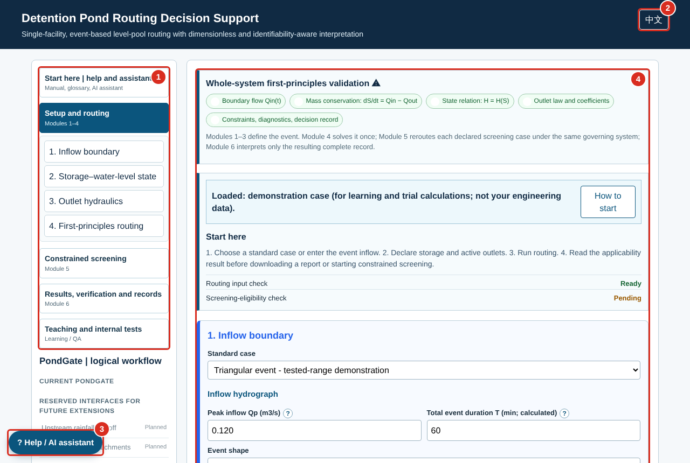

Figure 2-1: Screen layout of PondGate

1. Tab bar: switches between the five pages "Start here", "Setup and routing", "Constrained screening", "Results, verification and records" and "Teaching and internal tests".
2. Language button.
3. Help / AI assistant button. You can press it at any time.
4. Work area: the content of the current page.

### Step 2-2  Get to know the "Start here" page

**What to do**

1. In the tab bar, press "Start here | help and assistant".

**What you should see**

- A row of tabs runs across the top of the page (1).
- The "Next step" box (2) changes as you work. When you first open it, it says that the demonstration case is loaded and that you can press run straight away.
- Below it are the basic steps 1 to 5 (3).

**If it looks different**

- You cannot find this page: it is the first tab in the tab bar.

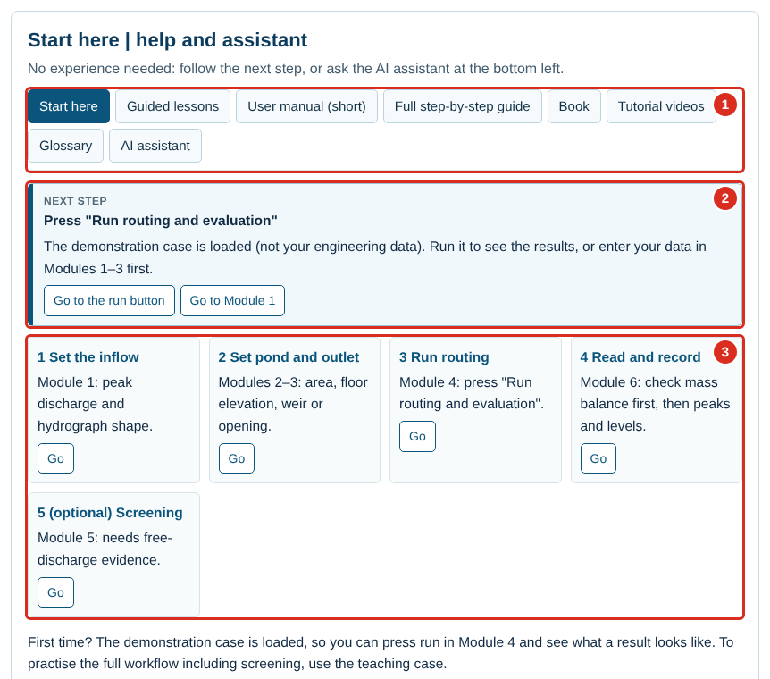

Figure 2-2: The "Start here" page

1. Tabs: Start here, Guided lessons, User manual, Full step-by-step guide, Book, Tutorial videos, Glossary and AI assistant.
2. "Next step" box: tells you what to do next, based on the current screen.
3. Five basic steps, each with a "Go" button.

### Step 2-3  Try the AI assistant

**What to do**

1. Press "? Help / AI assistant" at the bottom left.
2. Type "What is Qallow?" in the box and press Enter or "Ask".

**What you should see**

- The assistant explains the term. Its answer begins: "Allowable peak outflow Qallow…".
- This assistant is an "offline rule-based" guide. It answers from keywords and the screen state inside your browser. It does not connect to an outside AI service, sends no data, does not change your inputs and does not make engineering judgements for you.

**If it looks different**

- The assistant says it can answer only PondGate questions: ask again using a term or button name from the software.

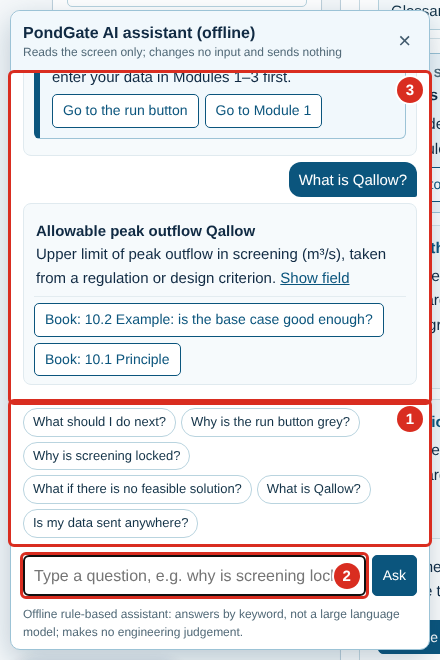

Figure 2-3: AI assistant (offline)

1. Common-question buttons. Press one to get an answer.
2. Type your own question here.
3. Questions and answers.

### Step 2-4  Close the assistant

**What to do**

1. Press "×" at the top right of the assistant window, or press the bottom-left button again.

**What you should see**

- The assistant window closes and the page is shown again.

## Chapter 3  Your first routing run: the demonstration case

In this chapter you run a complete routing calculation with the built-in demonstration case and learn to read the results. The demonstration case is a triangular inflow event. The water flows into a 180 m² pond and leaves through a sharp-crested weir 0.20 m wide.

### Step 3-1  Open the "Setup and routing" page

**What to do**

1. In the tab bar, press "Setup and routing".

**What you should see**

- The work area shows Module 1 "Inflow boundary". Below the tab are 1. Inflow boundary, 2. Storage–water-level state, 3. Outlet hydraulics and 4. First-principles routing.

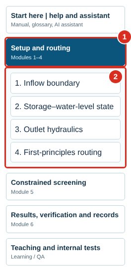

Figure 3-1: The "Setup and routing" tab and its module sub-items

1. The "Setup and routing" tab.
2. Sub-items for Modules 1 to 4. Press one to jump to that module.

### Step 3-2  Check Module 1: inflow boundary

**What to do**

1. Do not change any value. Just compare the fields with 1 to 6 in the figure.
2. Move the mouse over the "?" next to a field name, or press the "?", to see an explanation of that field.

**What you should see**

- Standard case = triangular event; peak inflow Qp = 0.120 m³/s; inflow shape = triangular; Tp = 30 min; Tr = 30 min; total event duration T = 60 min.
- A triangular inflow rises in a straight line from 0 to Qp in Tp minutes, then falls in a straight line back to 0 in Tr minutes.

**If it looks different**

- The values are different: reload the page to return to the demonstration values.

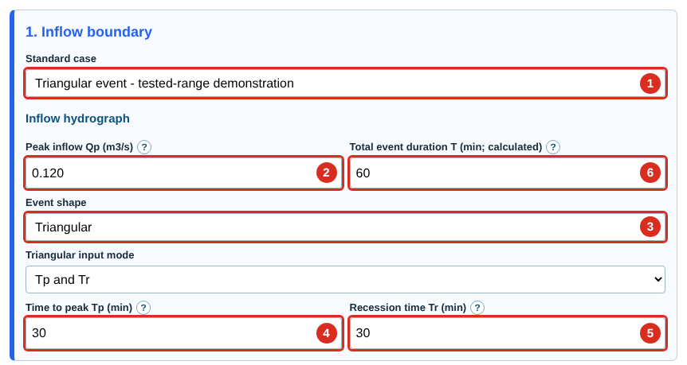

Figure 3-2: Module 1 inflow boundary (demonstration values)

1. Standard case: currently the triangular event (test-envelope demonstration).
2. Peak inflow Qp (m³/s).
3. Inflow shape: triangular.
4. Time to peak Tp (min).
5. Recession time Tr (min).
6. Total event duration T (computed automatically = Tp + Tr).

### Step 3-3  Check Module 2: storage–water-level state

**What to do**

1. In the tab bar, press "2. Storage–water-level state" and compare with 1 to 4 in the figure.

**What you should see**

- Storage representation = constant plan area. The pond walls are vertical, so the area is the same at every level, and the storage is S = A × (H − Hfloor).
- Floor elevation Hfloor = 0.00 m; plan area A = 180 m²; initial water level H0 = 0 m (the pond is empty when the event starts).

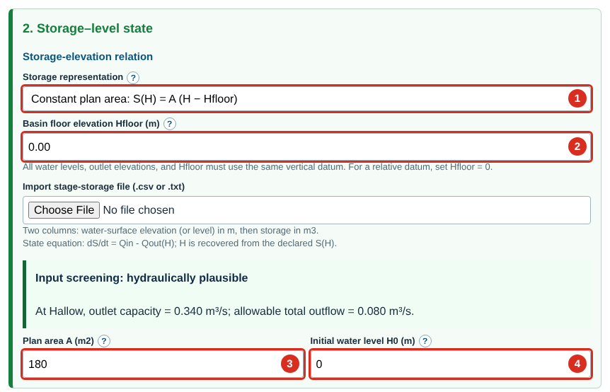

Figure 3-3: Module 2 storage–water-level state (demonstration values)

1. Storage representation: constant plan area.
2. Floor elevation Hfloor (m).
3. Plan area A (m²).
4. Initial water level H0 (m).

### Step 3-4  Check Module 3: outlet hydraulics

**What to do**

1. In the tab bar, press "3. Outlet hydraulics". Scroll down to "Sharp-crested weir" and compare with 1 to 5 in the figure.

**What you should see**

- Only "Sharp-crested weir" is ticked; Cw = 1.70; weir width b = 0.20 m; crest elevation = 0 m.
- The weir equation is Q = Cw × b × h^1.5, where h is the height of the water above the crest. The crest is at the pond floor, so water starts to flow over the weir as soon as it enters the pond.
- At the top of Module 3 there are also ticks and record fields for the "free-discharge boundary". You will use them in Chapter 8. Ignore them for now.

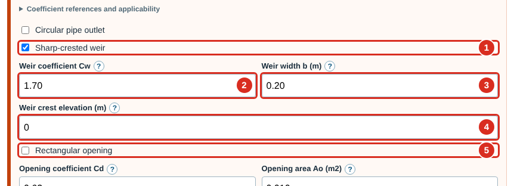

Figure 3-4: Module 3 outlet hydraulics: sharp-crested weir (demonstration values)

1. "Sharp-crested weir" is ticked.
2. Weir coefficient Cw.
3. Weir width b (m).
4. Crest elevation (m).
5. "Rectangular opening" is not ticked.

### Step 3-5  Run the routing

**What to do**

1. In the tab bar, press "4. First-principles routing".
2. Press the blue "Run routing and evaluation" button (1).

**What you should see**

- After about 1 second, the page switches to "Results, verification and records" (Module 6).

**If it looks different**

- The button is grey and cannot be pressed: a field has a wrong value. The fields to fix are listed above the button. See Chapter 7.

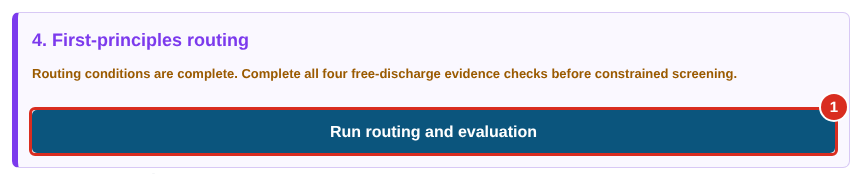

Figure 3-5: The run button in Module 4

1. The "Run routing and evaluation" button.

### Step 3-6  Look at the "Inflow and routed outflow" chart

**What to do**

1. In Module 6, find the "Inflow and routed outflow" chart (1).

**What you should see**

- The chart has two curves: inflow (Qin) and outflow (Qout). The inflow is a triangle. The outflow peak is lower and comes later than the inflow peak. This is the "peak reduction and delay" effect of a detention pond.
- The "Water level and storage" chart next to it (2) plots the water level (m) and the storage (m³) on the same axis. The two have very different sizes, so the level line stays close to 0. Read the water level from the results table in the next step.

**If it looks different**

- The chart is empty: go back to Module 4 and press run again.

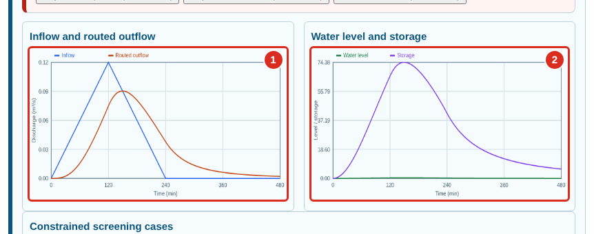

Figure 3-6: Routing result charts

1. Inflow and routed outflow chart.
2. Water level and storage chart.

### Step 3-7  Read the results table

**What to do**

1. Scroll down to the results table. First read the "Mass-balance residual ε/Vin" (5). Then read the peak outflow, peak ratio, detention volume and peak water level.

**What you should see**

- Mass-balance residual ε/Vin = 0.000 %. This is the conservation check of the numerical calculation. A value close to 0 means that the calculation did not lose or add water. Always read this item first.
- Peak outflow Qp,o = 0.0903 m³/s (the peak inflow is 0.1200 m³/s).
- Peak ratio RQ = 0.753. The outflow peak is about 75% of the inflow peak.
- Event-added detention volume ΔSmax = 74.385 m³. This is the largest extra volume stored in the pond during the event.
- Peak water level Hmax = 0.413 m. This is the highest level in the pond. Compare it with the allowable level and the freeboard.

**If it looks different**

- ε/Vin is clearly larger than 0: write down the inputs and report them. This is not normal.

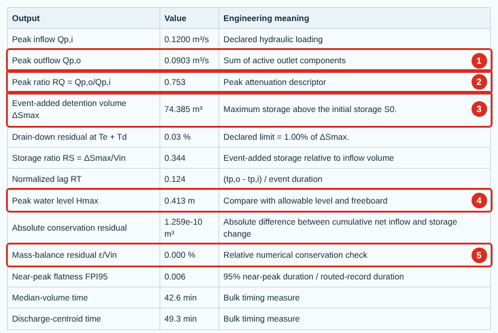

Figure 3-7: Results table (demonstration case)

1. Peak outflow Qp,o.
2. Peak ratio RQ.
3. Event-added detention volume ΔSmax.
4. Peak water level Hmax.
5. Mass-balance residual ε/Vin.

### Step 3-8  Download the traceable record

**What to do**

1. Below the results table, press "Download reproducible decision-support report" (1).
2. If the browser asks whether to save the file, choose save.

**What you should see**

- The browser downloads a text file (file name detention-pond-routing-run-record.txt).
- The file records all inputs, calculation settings, results and time series of this run. Attach it to homework or reports so that others can reproduce your result.

**If it looks different**

- Nothing is downloaded: check whether the browser blocks downloads.

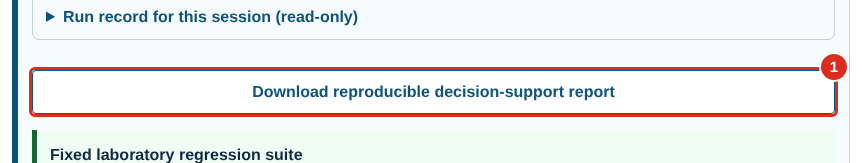

Figure 3-8: Download the traceable record

1. The "Download reproducible decision-support report" button.

## Chapter 4  Change the inputs and compare the results

In this chapter you change one condition at a time and watch how the results change. Have a sheet of paper or a spreadsheet ready to record each result.

### Step 4-1  Use a larger event

**What to do**

1. Reload the page to return to the demonstration values (switch to English again if needed).
2. In Module 1, change the peak inflow Qp to 0.20, the time to peak Tp to 20 and the recession time Tr to 40.

**What you should see**

- The total event duration T changes automatically to 60 min (20 + 40).

**If it looks different**

- T does not change: click outside the field so that the input takes effect.

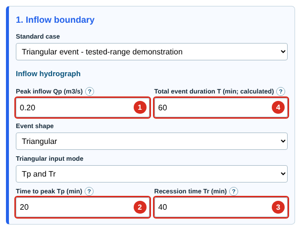

Figure 4-1: Changing the inflow conditions

1. Peak inflow Qp changed to 0.20.
2. Tp changed to 20.
3. Tr changed to 40.
4. T becomes 60 automatically.

### Step 4-2  Run and record result A

**What to do**

1. In Module 4, press "Run routing and evaluation".
2. From the results table, write down the peak outflow Qp,o, the peak ratio RQ, ΔSmax and the peak water level Hmax.

**What you should see**

- Result A: Qp,o = 0.1512 m³/s, RQ = 0.756, ΔSmax = 104.854 m³, Hmax = 0.583 m.

### Step 4-3  Enlarge the pond and record result B

**What to do**

1. In Module 2, change the plan area A from 180 to 250. Leave everything else as it is.
2. In Module 4, press run and write down result B.

**What you should see**

- Result B: Qp,o = 0.1335 m³/s, RQ = 0.667, ΔSmax = 134.033 m³, Hmax = 0.536 m.

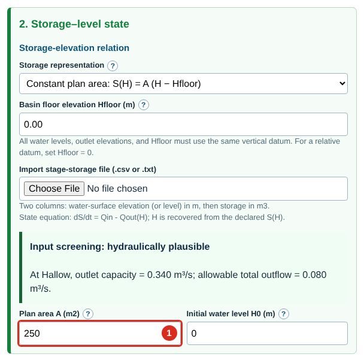

Figure 4-2: Changing the plan area to 250 m²

1. Plan area A changed to 250.

### Step 4-4  Widen the weir and record result C

**What to do**

1. In Module 3, change the weir width b from 0.20 to 0.30 (keep the pond area at 250).
2. In Module 4, press run and write down result C.

**What you should see**

- Result C: Qp,o = 0.1482 m³/s, RQ = 0.741, ΔSmax = 109.702 m³, Hmax = 0.439 m.

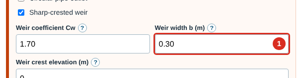

Figure 4-3: Changing the weir width to 0.30 m

1. Weir width b changed to 0.30.

### Step 4-5  Compare the three results

**What to do**

1. Put the three results into Table 4-1 and answer the two questions below.

**What you should see**

- A → B (larger pond): the same water spreads over a larger area, so the level rises less and Hmax falls. The pond can store more water, so the outflow peak also falls.
- B → C (wider weir): the outlet can pass more water, so the water leaves faster. Hmax falls, but the outflow peak rises and the peak reduction becomes weaker.
- Conclusion: a larger pond area lowers both the water level and the outflow. A wider outlet lowers the water level but increases the outflow downstream. A design must balance the two. Constrained design screening in Chapter 8 deals with this problem.

Table 4-1  Comparison of the three runs (values read while this guide was made)

|  | Condition | Peak outflow Qp,o | Peak ratio RQ | ΔSmax | Peak water level Hmax |
| --- | --- | --- | --- | --- | --- |
| A | Qp 0.20, A 180, b 0.20 | 0.1512 m³/s | 0.756 | 104.854 m³ | 0.583 m |
| B | Pond area changed to 250 | 0.1335 m³/s | 0.667 | 134.033 m³ | 0.536 m |
| C | Weir width then changed to 0.30 | 0.1482 m³/s | 0.741 | 109.702 m³ | 0.439 m |

## Chapter 5  Describe an irregular pond with a stage–storage table

Real pond walls are often sloped, so the area differs from level to level. In that case use a "stage–storage table S(H)" and enter the storage for each water level, row by row.

### Step 5-1  Switch to a stage–storage table

**What to do**

1. Reload the page. In Module 2, set "Storage representation" to the stage–storage table S(H).

**What you should see**

- A table input box appears (2). By default it has three rows: 0, 0 / 0.50, 90 / 1.00, 180. This is exactly a vertical-walled pond with an area of 180 m².
- The "Plan area A" and "Floor elevation" fields disappear, because the table already contains this information.

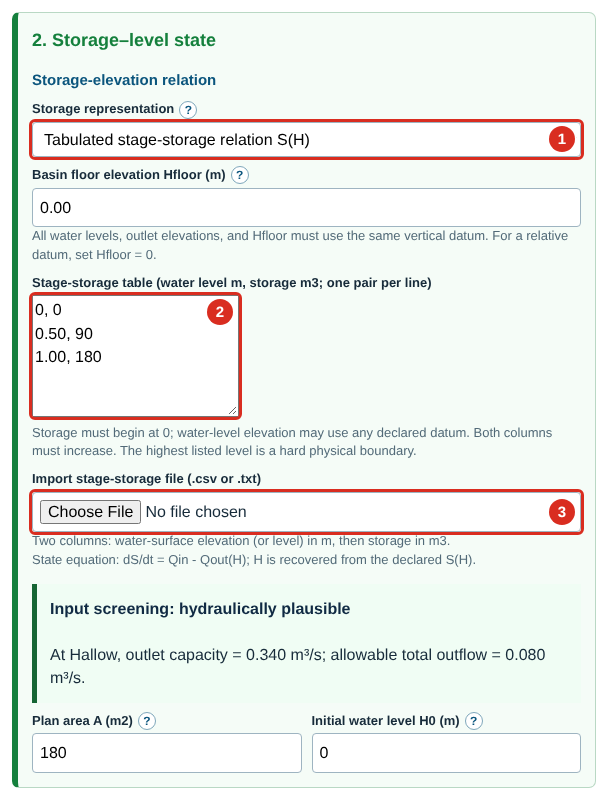

Figure 5-1: Stage–storage table mode

1. Storage representation changed to the stage–storage table S(H).
2. Stage–storage table; each row is "level, storage".
3. You can also import a .csv or .txt file.

### Step 5-2  Enter a pond that is wider at the top

**What to do**

1. Replace the table with the three rows below (one pair per row, separated by a comma):
2. 0, 0
3. 0.50, 120
4. 1.00, 300
5. In Module 4, press "Run routing and evaluation".

**What you should see**

- Between 0 and 0.5 m this pond has an average area of 240 m², and between 0.5 and 1.0 m it has 360 m². It is larger than the demonstration pond. Results: Qp,o = 0.0801 m³/s and Hmax = 0.381 m, both lower than in the demonstration case (Chapter 3).

**If it looks different**

- A red message says that the stage–storage table must start at storage 0: check that the first row is 0, 0 and that both the level and the storage increase row by row.

### Step 5-3  What happens when the table is too short

**What to do**

1. On purpose, change the table so that it reaches only 0.30 m:
2. 0, 0
3. 0.15, 30
4. 0.30, 70
5. Press "Run routing and evaluation".

**What you should see**

- The run is stopped. The page stays in Module 4, and a red message appears above the button: "Correct the highlighted input before routing Initial water level and reference level Href must lie within the declared stage-storage table range."
- Press "Go to the outlined field" after the message. The page jumps to the table in Module 2, which now has a red outline.
- PondGate does not extrapolate (guess) beyond the table, because that would give results without a basis.
- If you now open the "Results, verification and records" page, a red warning above the results table says that the charts and results below are from the previous successful run and must not be cited.

**If it looks different**

- Solution: extend the table above the highest likely water level (and above the reference level Href = 1.00 m in Module 5). For example, add the rows "0.60, 160" and "1.00, 300", then run again.

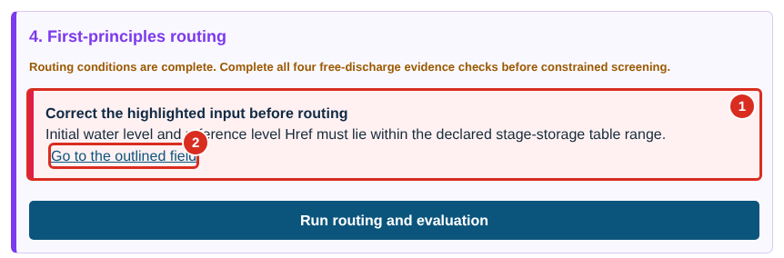

Figure 5-2: The table range is too short, so the run is stopped

1. Red message: explains why this run was stopped.
2. The "Go to the outlined field" button.

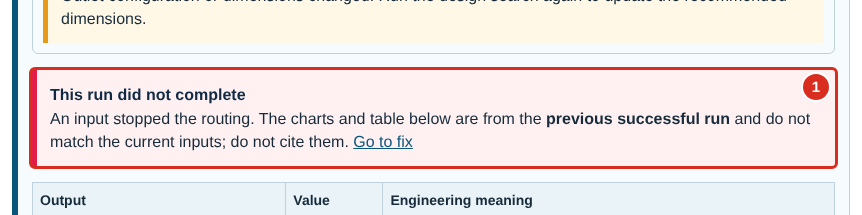

Figure 5-3: Warning on the results page

1. Warning: the results below are from the previous successful run and do not match the current inputs.

### Step 5-4  Import the table from a file

**What to do**

1. Create a file in Notepad or Excel. Put the water level (m) in the first column and the storage (m³) in the second column, one pair per row, for example:
2. 0,0
3. 0.5,120
4. 1.0,300
5. Save it as a .csv or .txt file. Start the first row with numbers; do not add a header row.
6. In Module 2, press the file button next to "Import stage–storage file" and choose the file.

**What you should see**

- The file contents fill the table, and the mode switches to the stage–storage table automatically.

**If it looks different**

- After importing, the run shows the message that the table must start at storage 0: usually the first row contains column names (for example "level,storage"). Delete that row.

### Step 5-5  Return to constant plan area

**What to do**

1. Set "Storage representation" back to constant plan area, or reload the page.

**What you should see**

- The plan area A and floor elevation fields appear again.

## Chapter 6  Long-duration events and timing

When the inflow lasts a long time and the peak is flat, the outflow peak is also flat. Then "the minute at which the peak occurs" is not a stable number. Report volume-based timing measures instead.

### Step 6-1  Load the long-duration event

**What to do**

1. Reload the page. In Module 1, set "Standard case" to the long-duration event (timing-interpretation demonstration).

**What you should see**

- The inflow shape changes to a long flat-topped hydrograph: rise 24 min, plateau 72 min, recession 24 min, total event duration 120 min. The peak inflow is still 0.120 m³/s.

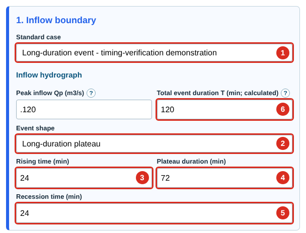

Figure 6-1: Inflow settings of the long-duration event

1. Standard case changed to the long-duration event.
2. Inflow shape changes automatically to the long flat-topped shape.
3. Rise time.
4. Plateau duration.
5. Recession time.
6. Total event duration.

### Step 6-2  Run and read the timing measures

**What to do**

1. In Module 4, press "Run routing and evaluation".
2. In the results table, find the peak ratio RQ, the near-peak flatness FPI95, the median-volume time and the discharge-centroid time.

**What you should see**

- Peak ratio RQ = 1.000. The plateau lasts long enough for the pond to fill until the outflow equals the inflow, so there is almost no peak reduction. A detention pond has limited peak reduction for long-duration events.
- FPI95 = 0.036; median-volume time = 72.5 min; discharge-centroid time = 74.6 min.
- The median-volume time is the time when the cumulative outflow reaches half of its total. The discharge-centroid time is the time-weighted mean of the outflow. Both use the water volume of the whole event, so they do not jump because of small changes near the peak.

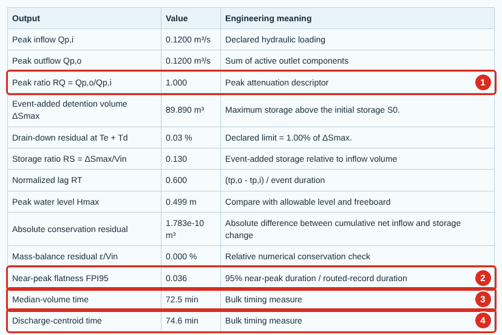

Figure 6-2: Results table of the long-duration event

1. Peak ratio RQ.
2. Near-peak flatness FPI95.
3. Median-volume time.
4. Discharge-centroid time.

### Step 6-3  Read the timing warning

**What to do**

1. Follow steps 8-1 and 8-2 in Chapter 8: tick free discharge and fill in the two records (teaching assumptions for practice).
2. Press "Run routing and evaluation" again and find the yellow message box below the results table.

**What you should see**

- The message box says: "Verify timing interpretation The response contains a broad near-peak interval. Peak discharge and volume may be stable, but a single point peak time should not be used alone for coordination or warning decisions. Report interval-based and bulk timing evidence."
- If the free-discharge settings are not complete, the same place first warns that the free-discharge evidence is incomplete. So you must complete the settings before you see this timing message.

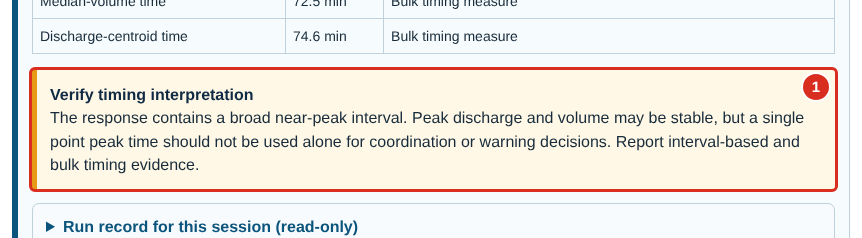

Figure 6-3: Timing-interpretation warning for the long-duration event

1. Timing-interpretation warning.

### Step 6-4  Rules for reading timing

**What to do**

1. Read the rules below and answer the question at the end.

**What you should see**

- When the peak is flat, a tiny numerical change can move the "outflow peak time" a lot. Do not report it on its own.
- Report FPI95 together with the median-volume time or the discharge-centroid time. A larger FPI95 means a flatter peak. For long-duration events, or when FPI95 is above 0.12, PondGate reminds you to check the timing interpretation.
- Question: when the peak is flat, which time should you report first? Answer: the volume-based timing measures (median-volume time and discharge-centroid time), together with FPI95.

## Chapter 7  Find and fix wrong inputs

When an input is not reasonable, PondGate does not compute a wrong result. It stops the run and tells you what to change. In this chapter you enter wrong values on purpose and practise reading the messages.

### Step 7-1  Set the peak inflow to 0

**What to do**

1. Reload the page. In Module 1, change the peak inflow Qp to 0.
2. Go to Module 4 and look at the run button.

**What you should see**

- The "Run routing and evaluation" button turns grey and cannot be pressed (2).
- Above the button is the list of fields to fix (1): "Peak inflow Qp must be greater than 0".

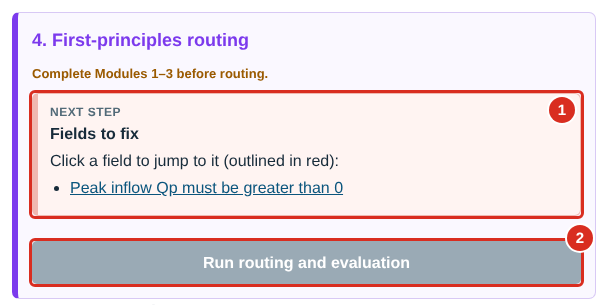

Figure 7-1: Message when the run button is blocked

1. List of fields to fix.
2. The run button turns grey.

### Step 7-2  Use the list to jump to the field

**What to do**

1. Press "Peak inflow Qp must be greater than 0" in the list.

**What you should see**

- The page jumps back to Module 1, and the Qp field has a red outline.

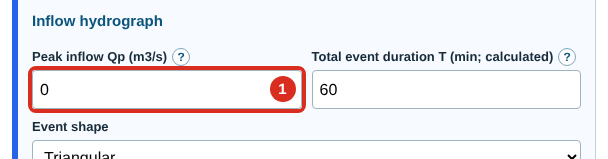

Figure 7-2: The field with a problem has a red outline

1. The field with a problem has a red outline.

### Step 7-3  Fix it and continue

**What to do**

1. Change Qp back to 0.120.

**What you should see**

- The red outline and the list disappear. The run button turns blue again and can be pressed.

### Step 7-4  Try another one: initial level below the floor

**What to do**

1. In Module 2, change the initial water level H0 to −0.1 (below the floor at 0.00).
2. Read the list in Module 4, then change H0 back to 0.

**What you should see**

- The list shows: "Initial level H0 must not be below the floor elevation Hfloor". After you change it back to 0, everything is normal again.

### Step 7-5  Common wrong inputs

**What to do**

1. See the error-message table in Appendix B.

**What you should see**

- Common errors include: a discharge or time of 0 or less; an initial level below the floor; a weir width or opening area of 0; an allowable level below the initial level; a stage–storage table that is too short or has column names in the first row.

## Chapter 8  Constrained design screening: find a feasible case

In the earlier chapters you gave the pond and the outlet and computed the level and the outflow. This chapter works the other way. You give the largest outflow allowed downstream, Qallow, and the highest level allowed in the pond, Hallow. PondGate then tries many combinations of pond area and weir width within the declared range and finds a case that meets the limits.

Formal constrained screening runs only when the outlet is "one weir or one rectangular opening with confirmed free discharge". Free discharge means that the water level downstream of the outlet does not affect the outflow. So you must first complete four checks and two records. In this chapter, all checks and records are "teaching assumptions (practice only)".

### Step 8-1  Tick the free-discharge boundary and the four checks

**What to do**

1. Reload the page. In Module 3, tick the free-discharge boundary (1).
2. Then tick the four checks below it (2 to 5).

**What you should see**

- All five boxes are ticked.

**If it looks different**

- In real work, tick them only when drawings, site checks or hydraulic calculations support them.

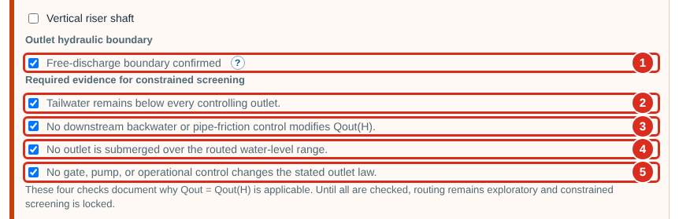

Figure 8-1: Free-discharge boundary and the four checks

1. Free-discharge boundary confirmed.
2. Tailwater is below all controlling outlets.
3. Downstream backwater or pipe friction does not change Qout(H).
4. The outlet is not submerged.
5. Gates, pumps or operation do not change the outlet law.

### Step 8-2  Fill in the two records

**What to do**

1. In the free-discharge evidence record, enter:
2. Teaching assumption (practice only): a single sharp-crested weir with free discharge, not affected by tailwater, backwater, submergence or operational control.
3. In the basis for the screening limits, enter:
4. Teaching assumption (practice only): Qallow = 0.080 m³/s and Hallow = 1.00 m.

**What you should see**

- Both fields contain text. Both texts are written into the downloaded report, so others can see the basis of the decision.

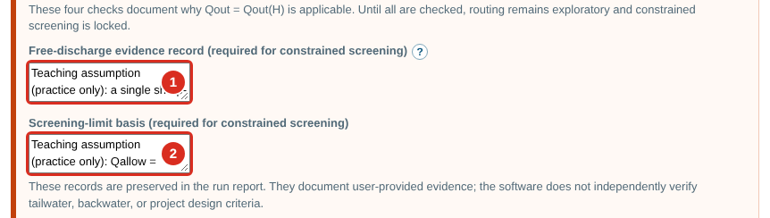

Figure 8-2: The two required records

1. Free-discharge evidence record.
2. Basis for the screening limits.

### Step 8-3  Run the routing once first

**What to do**

1. In Module 4, press "Run routing and evaluation" so that the results match the current inputs.

**What you should see**

- The page switches to Module 6 and shows the results of the demonstration case (the same as in Chapter 3).

### Step 8-4  Set the limits

**What to do**

1. In the tab bar, press "Constrained screening" (Module 5).
2. Check: allowable peak outflow = 0.080 m³/s; allowable water level = 1.00 m; Href = 1.00 m; maximum drain-down time Td = 24 h; allowable residual = 1 %.

**What you should see**

- Qallow is the largest outflow that the downstream system can accept. Hallow is the highest level that the pond must not exceed. Both should come from regulations or design criteria. Do not relax them just to get a result.
- Td and the residual percentage require that, within Td hours after the event, the pond drains until only a very small part of the event storage is left, ready for the next storm.

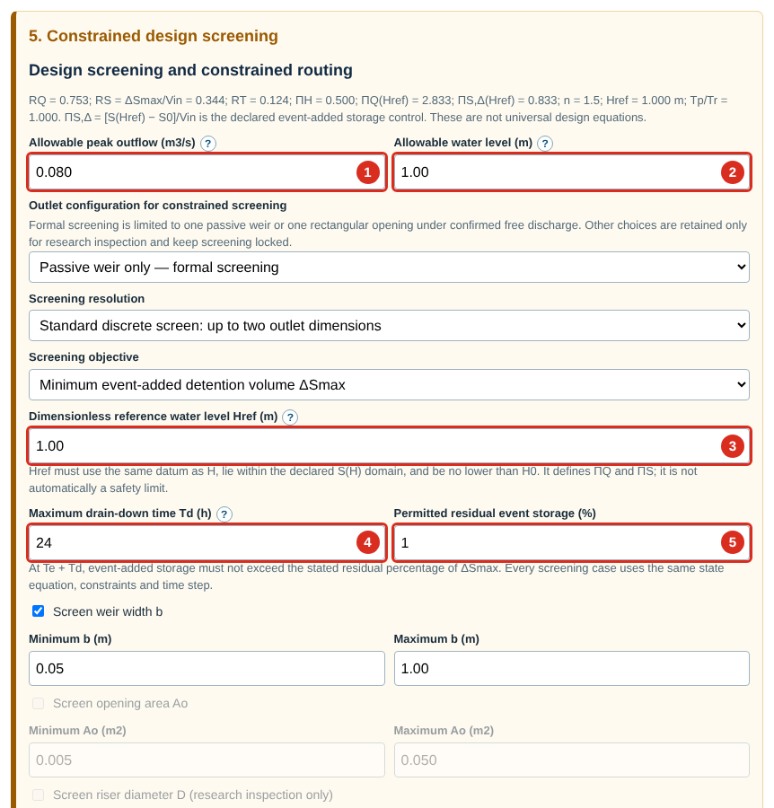

Figure 8-3: Limits in Module 5

1. Allowable peak outflow Qallow.
2. Allowable water level Hallow.
3. Dimensionless reference level Href.
4. Maximum drain-down time Td.
5. Allowable event-added storage residual.

### Step 8-5  Set the outlet configuration and the search range

**What to do**

1. Check: outlet configuration = passive weir only (formal screening); screening resolution = standard discrete screening; objective = minimum event-added detention volume ΔSmax; weir width range 0.05 to 1.00 m.

**What you should see**

- The software tries many combinations of pond area and weir width within this range. It recomputes each one with the same RK4 routing.

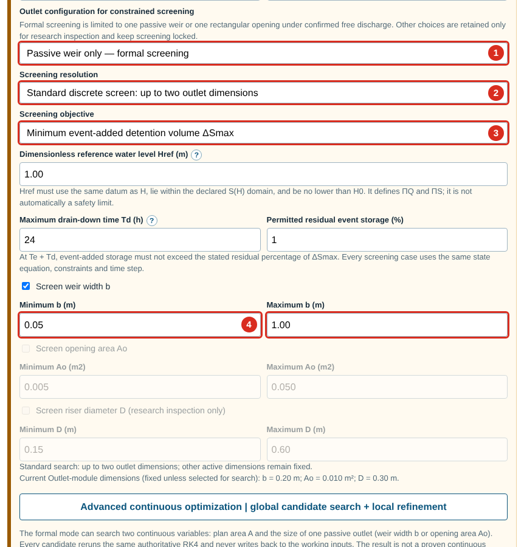

Figure 8-4: Outlet configuration, objective and search range

1. Outlet configuration for screening: passive weir only.
2. Screening resolution.
3. Screening objective.
4. Maximum weir width.
5. The "Run constrained design screening" button.

### Step 8-6  Run constrained design screening

**What to do**

1. Press "Run constrained design screening" and wait about 5 to 10 seconds.

**What you should see**

- The page switches to "Results, verification and records" and shows "Selected feasible constrained-screening case — routed".
- Selected pond area A = 460 m², weir width b = 0.53 m; peak outflow / allowable = 0.0798 / 0.0800 m³/s; peak water level / allowable = 0.200 / 1.000 m; drain-down residual = 0.07 / 1.00%.
- Every item is within its limit.

**If it looks different**

- The button is grey: the free-discharge ticks or the two records are not complete, or the outlet is not one weir or one opening. A message below the button explains why and offers "Go to fix".

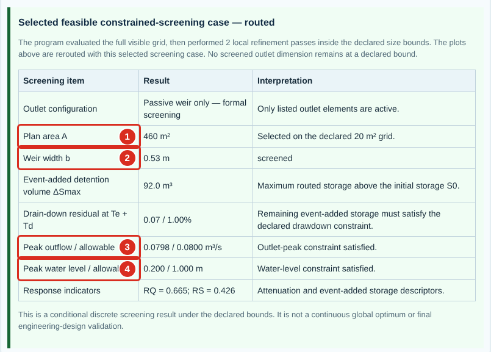

Figure 8-5: Constrained screening result (feasible)

1. Selected pond area.
2. Selected weir width.
3. Peak outflow and allowable value.
4. Peak water level and allowable value.

### Step 8-7  Read the three-step check

**What to do**

1. Below the screening result, find "Screening / optimization result check | three steps".

**What you should see**

- Step 1: screening computation status = "Pass | Screening completed".
- Step 2: outlet type, maximum level, peak outflow, drain-down residual and S(H) boundary, and the four free-discharge evidence checks all show "Pass".
- Step 3: the current result meets the declared conditions; final engineering-design validation is still required.

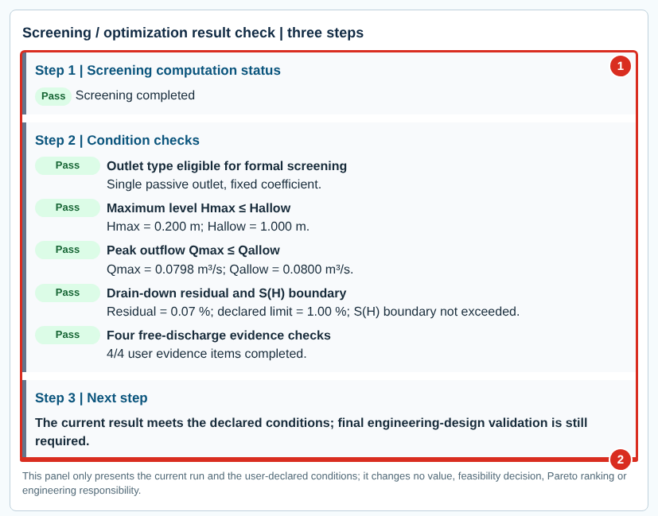

Figure 8-6: Three-step check (feasible)

1. Steps 1 to 3.
2. Check result for each condition.

### Step 8-8  Note: the inputs now hold the selected values

**What to do**

1. Go back to Modules 2 and 3 and look at the plan area A and the weir width b.

**What you should see**

- After screening, the plan area in Module 2 changed from 180 to 460 m², and the weir width in Module 3 changed from 0.20 to 0.525 m. The charts and results table above show the routing of the selected case. To return to the original demonstration values, reload the page.

### Step 8-9  Download the report

**What to do**

1. Press "Download reproducible decision-support report".

**What you should see**

- The report contains the limits, the free-discharge records, the screening result and the three-step check.

## Chapter 9  No feasible case: understanding "Blocked"

If the limits are too strict, no combination in the declared range may meet them. PondGate then shows "Blocked" clearly and names the limits that caused it. It never shows "Pass" in this case.

### Step 9-1  Make the allowable outflow very strict

**What to do**

1. Reload the page. Follow steps 8-1 to 8-3 in Chapter 8: tick free discharge, fill in the two records and run the routing once.
2. In Module 5, change the allowable peak outflow Qallow to 0.010.

**What you should see**

- The Qallow field shows 0.010.

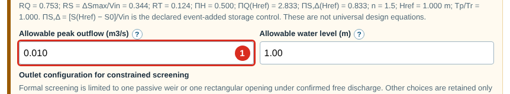

Figure 9-1: Changing Qallow to 0.010

1. Allowable peak outflow changed to 0.010.

### Step 9-2  Run screening and see "Blocked"

**What to do**

1. Press "Run constrained design screening".

**What you should see**

- The screening result says: "No feasible screening case was found within the declared physical bounds and discrete screening domain. Dominant constraints observed: peak-outflow limit, maximum-water-level limit, drain-down residual limit. Consider pond area, weir width, or opening area only with engineering basis; do not relax Qallow or Hallow arbitrarily."
- In the three-step check, step 1 shows "Blocked | No feasible solution", and step 3 lists the dominant limits with "Go to fix" links.

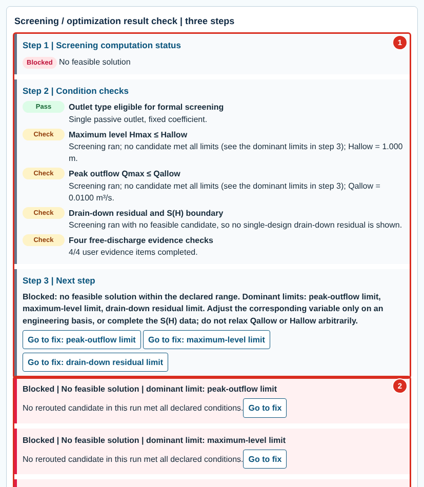

Figure 9-2: Three-step check when no feasible case exists

1. Step 1 shows "Blocked | No feasible solution"; step 3 lists the dominant limits.
2. Each dominant limit has a "Go to fix" link.

### Step 9-3  The right way to respond

**What to do**

1. Read the rules below, then change Qallow back to 0.080.

**What you should see**

- Do not relax Qallow or Hallow just to get a result, because they come from regulations or design criteria.
- What you can do: change the pond area or the outlet size on an engineering basis, widen the search range where there is a basis for it, or add S(H) data.
- "Blocked" is a useful result in itself. It tells you that this design direction cannot work under the current conditions.

## Chapter 10  Research-inspection mode: outlets that cannot be screened formally

Formal constrained screening in PondGate is verified only for "one weir" or "one rectangular opening". If you use several outlets at once, or a riser, a circular pipe or a stage-dependent coefficient table, routing still works, but constrained screening is locked and the result is for research inspection only.

### Step 10-1  Add a rectangular opening to make a combined outlet

**What to do**

1. Reload the page and complete the free-discharge ticks and the two records as in Chapter 8.
2. In Module 3, tick "Rectangular opening" in addition to the sharp-crested weir.

**What you should see**

- Fields for the rectangular opening appear: discharge coefficient Cd, opening area Ao, opening height and invert elevation.

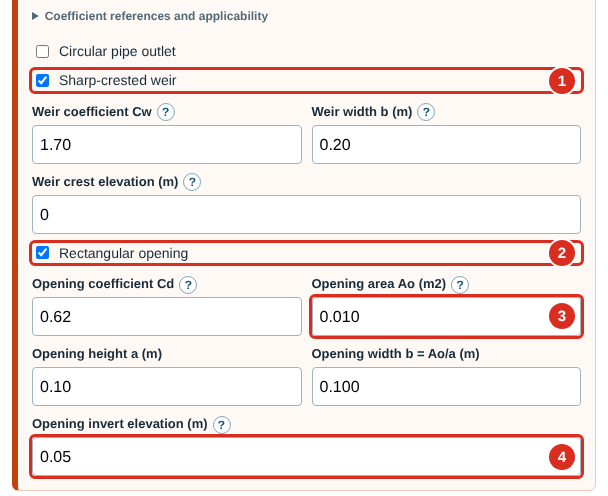

Figure 10-1: Combined outlet: weir plus rectangular opening

1. Sharp-crested weir (ticked).
2. Rectangular opening (newly ticked).
3. Opening area Ao.
4. Opening invert elevation.

### Step 10-2  Routing still runs

**What to do**

1. In Module 4, press "Run routing and evaluation".

**What you should see**

- Routing completes normally: Qp,o = 0.0927 m³/s, Hmax = 0.378 m. You can read the result, but the outflow is the sum of the weir and the opening.

### Step 10-3  Constrained screening is locked

**What to do**

1. In Module 5, scroll down to the "Run constrained design screening" button.

**What you should see**

- A message below the button says "This outlet type is not eligible for formal constrained design screening; use one passive weir or one rectangular opening", with "Go to fix".
- You can also ask the AI assistant "Why is screening locked?" and it lists the reasons.

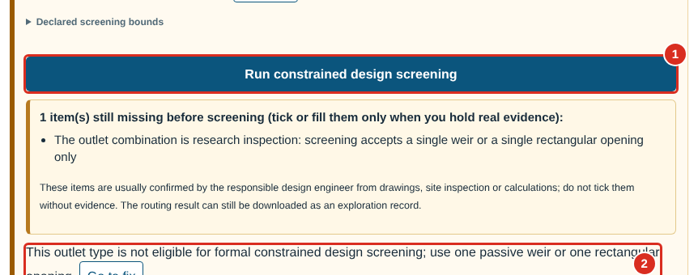

Figure 10-2: Constrained screening is locked for a combined outlet

1. The "Run constrained design screening" button is locked.
2. Reason for the lock and "Go to fix".

### Step 10-4  Return to a single outlet

**What to do**

1. In Module 3, untick "Rectangular opening".

**What you should see**

- The lock reason disappears, and constrained screening can run again.

## Chapter 11  Advanced continuous optimization (optional)

The constrained screening in Chapter 8 tries values on a fixed grid. Advanced continuous optimization searches continuous ranges of the area A and the weir width b. It considers two objectives at once (detention volume and water level) and lists a set of trade-off alternatives (Pareto alternatives).

### Step 11-1  Run advanced continuous optimization

**What to do**

1. Complete the free-discharge ticks, the two records and one routing run as in Chapter 8.
2. In Module 5, press "Advanced continuous optimization | global candidate search + local refinement" and wait about 20 seconds.

**What you should see**

- The result says: "The authoritative RK4 routing core evaluated 220 candidates; 147 nondominated feasible alternatives are shown. The first Pareto alternative is selected for a complete routed record below. This is a global-candidate-search result, not a proven continuous global optimum and not final engineering-design validation."
- Each row of the table is one feasible alternative: area, weir width, ΔSmax, Hmax, Qmax and the margin left to each limit. No alternative is best for every objective. The designer must choose based on engineering judgement.

**If it looks different**

- This is still not a proven global optimum and not a final engineering design.

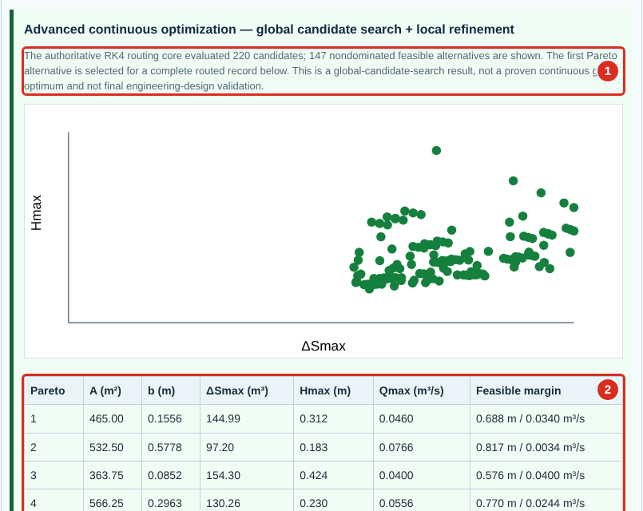

Figure 11-1: Pareto alternatives from advanced continuous optimization

1. Search summary.
2. Table of Pareto alternatives.

## Chapter 12  Cross-checking with external models (optional)

If you use HEC-HMS or SWMM, you can build a model with the same inflow, storage relation and outlet, and import its results into PondGate for comparison. This is a cross-check of the numerical implementation, not a field validation.

### Step 12-1  Get to know the cross-check area

**What to do**

1. Run the routing once. On the "Results, verification and records" page, scroll down to the external model cross-check.

**What you should see**

- For the "PondGate reference hydrograph" you can choose the current interactive routing result or one of the four public benchmark cases A-005 to D-005.
- The first row of the CSV must hold the column names. It needs at least time_s (seconds) and outflow_m3_s (m³/s); a full comparison also needs incremental_storage_m3. Press the button to download the external result CSV template to see the format.
- After importing the actual output file of the external model, press "Compare external result".

**If it looks different**

- Do not import an inflow file, a model setup file or an output file of PondGate itself.

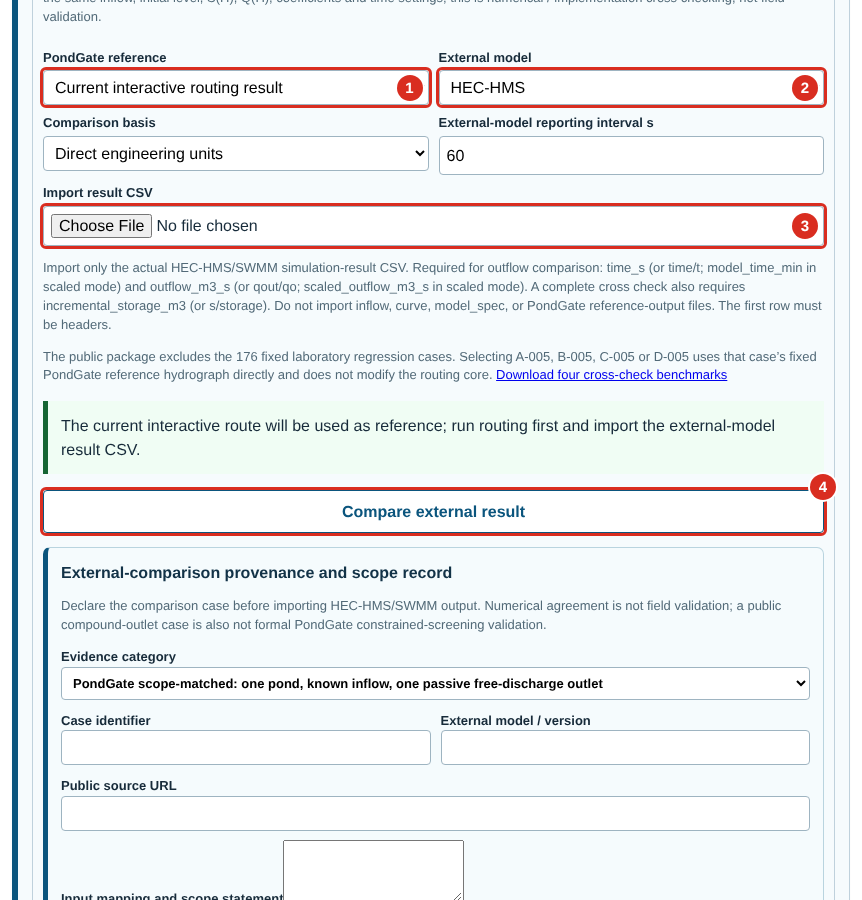

Figure 12-1: External model cross-check area

1. PondGate reference hydrograph.
2. External model: HEC-HMS or SWMM.
3. Import the external model result CSV.
4. The "Compare external result" button.
5. Download the CSV template (column names only).

### Step 12-2  Look at a completed three-engine comparison

**What to do**

1. In the tab bar, press "Teaching and internal tests" and find "E‑W1 A‑005 external cross-check benchmark".
2. Press "Run E‑W1 A‑005 benchmark RK4".

**What you should see**

- The page switches to "Results, verification and records". "E‑W1 A‑005 comparison results" shows "Benchmark run complete: 3910 actual RK4 rows; comparison_results CSV can be exported.". This public case keeps stored results from EPA SWMM 5.2.4 and HEC‑HMS 4.13, so you can compare three engines on the same case.
- This case is a numerical verification case used in the research paper. It is not an engineering design case.

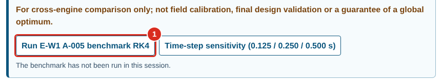

Figure 12-2: E‑W1 A‑005 benchmark case

1. The "Run E‑W1 A‑005 benchmark RK4" button.

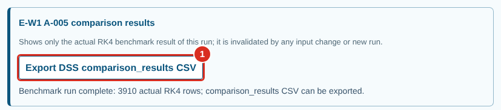

Figure 12-3: E‑W1 A‑005 comparison results (Results, verification and records page)

1. Export the comparison results CSV.

## Chapter 13  Guided lessons, teaching case and glossary

PondGate has 7 built-in guided lessons. A lesson shows its steps at the top right of the screen and ticks each step automatically when you finish it.

### Step 13-1  Open the list of guided lessons

**What to do**

1. On the "Start here" page, press the "Guided lessons" tab.

**What you should see**

- Lessons 1 to 7 are listed, each with a goal and a "Start" button. Finished lessons show "Done".

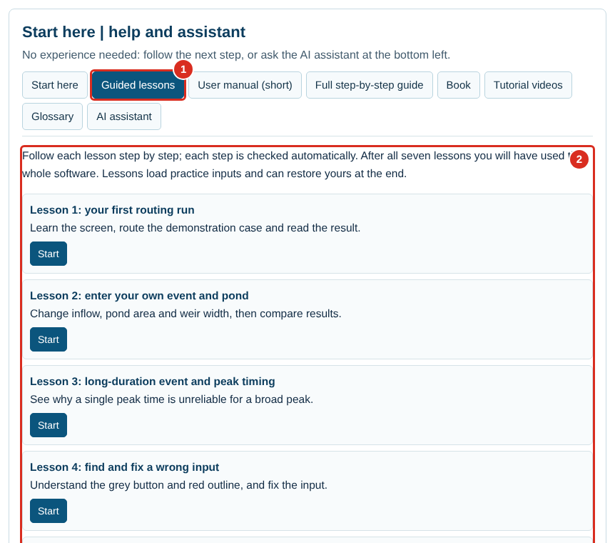

Figure 13-1: List of guided lessons

1. The "Guided lessons" tab.
2. Seven lessons. Press "Start" to begin one.

### Step 13-2  Do one lesson

**What to do**

1. Press "Start" for lesson 2. The software asks whether to load the lesson inputs for now. Press "OK".
2. Follow the panel. If you are not sure, press "Take me there" to jump to the field, or "Show me this step" to let the software do it.

**What you should see**

- A lesson panel appears at the top right and shows the current step. When you do it right, the step turns green and the lesson moves on.
- At the end of the lesson you can restore your original inputs.

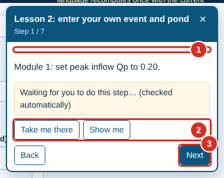

Figure 13-2: Lesson panel

1. Progress bar.
2. Buttons such as "Take me there" and "Show me this step".
3. Next step.

### Step 13-3  Use the glossary

**What to do**

1. Press the "Glossary" tab and type "free discharge" in the search box.

**What you should see**

- Related terms and explanations are listed. Press "Show field" to jump to that field.

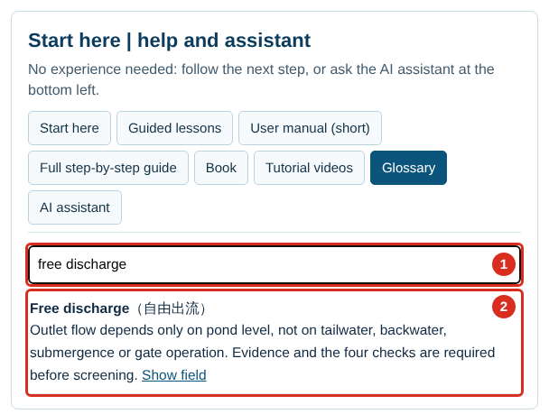

Figure 13-3: Glossary

1. Type a term to search.
2. Search results. Press "Show field" to jump to the field.

### Step 13-4  Teaching case (Teaching and internal tests page)

**What to do**

1. In the tab bar, press "Teaching and internal tests" and find the teaching assistant (four self-study steps and instant checks).
2. Press the button that loads the teaching case for constrained screening. The software first saves your current inputs, then loads teaching data that can run constrained screening at once. When you finish, press the button that restores the previous case.

**What you should see**

- Below are four learning steps and quick self-check questions, each taking about 30 seconds.

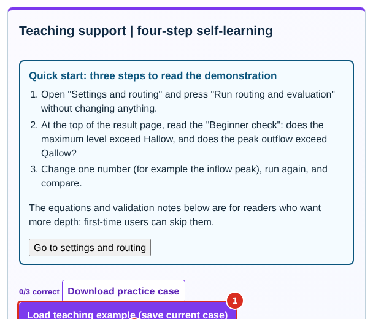

Figure 13-4: Teaching assistant area

1. Load a teaching case that can run constrained screening (the current case is saved first).
2. Restore the previous case.

## Appendix A  Glossary

| Term | Meaning |
| --- | --- |
| Peak inflow Qp | Largest discharge of the inflow hydrograph (m³/s). Must be greater than 0. |
| Time to peak Tp | Time for a triangular inflow to rise from 0 to its peak (min). |
| Recession time Tr | Time for a triangular inflow to fall from its peak to 0 (min). |
| Total event duration T | Total length of the inflow hydrograph (min), added up from the segment times. It cannot be typed. |
| Stage–storage relation S(H) | Relation between water level H and stored volume S. With constant area, S = A × (H − Hfloor). |
| Plan area A | Pond surface area in constant-area mode (m²). Must be greater than 0. |
| Floor elevation Hfloor | Elevation of the pond floor (m). All levels and outlet elevations must share its datum. |
| Initial level H0 | Water level in the pond when the event starts (m). Must not be below Hfloor. |
| Vertical datum | Common zero for elevations. Floor, levels, crest and invert must share it, or results are wrong. |
| Weir coefficient Cw | Coefficient in the weir law Q = Cw × b × (H − P)^1.5. The 1.70 preset is for preliminary screening only. |
| Weir width b | Crest length of the sharp-crested weir (m). |
| Crest elevation P | Water starts to spill once the level exceeds this elevation (m). |
| Discharge coefficient Cd | Coefficient in the opening law Q = Cd × Ao × √(2g(H − invert)). Preset 0.62. |
| Opening area Ao | Area of the rectangular opening (m²) = height a × width b. |
| Invert elevation | Lower edge of the rectangular opening (m). Outflow starts above it. |
| Research inspection | Riser, pipe, coefficient-table or combined-outlet settings. Routing works but constrained screening is locked; independent verification is needed. |
| Free discharge | Outlet flow depends only on pond level, not on tailwater, backwater, submergence or gate operation. Evidence and the four checks are required before screening. |
| Two evidence records | "Free-discharge evidence" and "screening-limit source": cite drawing or inspection IDs, checker and date, and the source of limits such as Qallow and Hallow. |
| RK4 | Fourth-order Runge–Kutta method that steps dS/dt = Qin − Qout with a fixed Δt = 2 s. |
| Mass-balance residual ε/Vin | Difference between cumulative net inflow and storage change, divided by inflow volume. Should be near 0 %; above 0.5 % the result must not be used. |
| Peak ratio RQ | RQ = peak outflow ÷ peak inflow. Smaller means more peak reduction. |
| Event-added detention ΔSmax | Largest storage added above the initial storage during the event (m³). |
| Storage ratio RS | RS = ΔSmax ÷ inflow volume Vin. |
| Dimensionless lag RT | RT = (time of peak outflow − time of peak inflow) ÷ event duration. |
| Maximum level Hmax | Highest pond level during the event (m). Compare with Hallow and freeboard. |
| Near-peak flatness FPI95 | Share of routed time with outflow above 95 % of its peak. A large value means a flat peak, so a single peak time is unreliable. |
| Allowable peak outflow Qallow | Upper limit of peak outflow in screening (m³/s), taken from a regulation or design criterion. |
| Allowable level Hallow | Upper limit of the maximum level in screening (m). Must not be below H0. |
| Drain-down time Td and residual | At event end Te plus Td, event-added storage must not exceed the stated percentage of ΔSmax. |
| Reference level Href | Level used only to define the dimensionless groups ΠQ and ΠS (m). Not automatically a safety limit. |
| Dimensionless groups ΠH, ΠQ, ΠS | Ratios that scale level, outlet capacity and storage by the inflow, used to compare cases. Not general design formulas. |
| Constrained screening | Reruns routing over the declared bounds to find feasible pond areas and outlet sizes under the declared limits. Not a final design. |
| Continuous optimization | Continuous search of area A and one outlet size between bounds, then local refinement. Not a proven global optimum. |
| Blocked / no feasible solution | No candidate within the current limits and bounds meets every condition. The software shows the dominant limit and a correction path, never "pass". |
| Numerical consistency | PondGate and HEC-HMS or SWMM give close results under identical inputs and physics. Not field calibration or general validation. |
| 176-case regression | Release check that reruns 176 laboratory cases (352 raw series) through the RK4 core. Peak-discharge MARE: A 2.924 %, B 2.954 %, C 4.104 %, D 4.649 %. |

## Appendix B  Error messages and fixes

Table B-1  Common error messages

| Message (shown above the run button) | Cause | How to fix it |
| --- | --- | --- |
| Peak inflow Qp must be greater than 0 | Qp is 0, negative or empty | Enter a discharge greater than 0 (m³/s) |
| Initial level H0 must not be below the floor elevation Hfloor | H0 is lower than Hfloor | Set H0 equal to or above Hfloor |
| Initial water level and reference level Href must lie within the declared stage-storage table range | The highest level in the S(H) table is too low | Extend the table to a higher level, or change H0 or Href |
| The stage–storage table must start at storage 0 … | The first row is not 0, 0; there is a header row; values do not increase row by row | Delete the header row and check that the values increase |
| Routed water level exceeds the declared stage–storage table range | The event level rises above the top of the table | Extend the S(H) table |
| An imported inflow hydrograph needs at least two "time, discharge" pairs … | The custom hydrograph has a format error | Each row is "time (min), discharge", with time starting at 0 and increasing |
| This outlet type is not eligible for formal constrained design screening | A combined outlet, riser, circular pipe or coefficient table is used | Return to one weir or one rectangular opening, or use the result for research inspection only |
| Blocked: four free-discharge evidence checks | The free-discharge ticks or the two records are not complete | Complete the ticks and records as in Chapter 8 |
| No feasible screening case was found … | The limits are too strict or the search range is too small | Adjust on an engineering basis; never relax the limits arbitrarily |

## Appendix C  Student checklist

- [ ] I can say what PondGate can and cannot do (Chapter 1)
- [ ] I can find the tabs, the language button, the help button and the work area (Chapter 2)
- [ ] I can run the demonstration case and read ε/Vin, Qp,o, RQ, ΔSmax and Hmax (Chapter 3)
- [ ] I can download the traceable record (Chapter 3)
- [ ] I can change one condition at a time and compare the results (Chapter 4)
- [ ] I can enter a stage–storage table and know that a table that is too short stops the run (Chapter 5)
- [ ] I can explain why volume-based timing measures are used for broad, flat peaks (Chapter 6)
- [ ] I can fix wrong inputs from the list (Chapter 7)
- [ ] I can complete the free-discharge settings and run constrained design screening (Chapter 8)
- [ ] I can read "Blocked" and say how to respond correctly (Chapter 9)
- [ ] I can name the outlet settings that lock constrained screening (Chapter 10)

## Appendix D  Exercises and answers

1. In the demonstration case, change only the peak inflow Qp to 0.15. What are the peak water level Hmax and the peak ratio RQ?
   - Answer: Hmax = 0.488 m, RQ = 0.772. A larger inflow raises the water level.
2. In the demonstration case, change only the plan area A to 360 m². What is the peak outflow Qp,o, and how does it compare with the demonstration case?
   - Answer: Qp,o = 0.0636 m³/s, lower than 0.0903 m³/s in the demonstration case. A larger pond reduces the peak more.
3. In the demonstration case, change only the weir width b to 0.10 m. What is the peak water level Hmax? Does it exceed the allowable level of 1.00 m?
   - Answer: Hmax = 0.570 m, which does not exceed 1.00 m. A narrower outlet raises the water level.
4. After completing the free-discharge settings as in Chapter 8, change the allowable outflow Qallow to 0.060 and run constrained design screening. Is there a feasible case? What pond area and weir width are selected?
   - Answer: Yes. Pond area A = 500 m², weir width b = 0.29 m, peak outflow / allowable = 0.0600 / 0.0600 m³/s. A stricter limit needs a larger pond.
5. When the screening result is "Blocked", may you raise Qallow until a feasible case appears? Why?
   - Answer: No. Qallow and Hallow come from regulations or design criteria and stand for the safety limits of the downstream system and the pond. Change the pond area, the outlet size or the search range only on an engineering basis.
6. Why should you always read the mass-balance residual ε/Vin first?
   - Answer: It checks whether water is conserved during the calculation. If it is clearly not 0, the calculation has a problem and none of the other numbers can be trusted.
