# PondGate 完整版操作手冊（學生逐步版）

PondGate v1.1.0。本手冊由 `docs/build_student_guide.js` 在軟體上逐步實際操作產生；文中數值與截圖都來自該次操作。

## 第 1 章　開始之前

PondGate 是一套在瀏覽器中執行的滯洪池演算軟體。給它一場已知的入流歷線（流量隨時間的變化）、池的水位—蓄水量關係與出口構造，它會一步一步算出池內水位、蓄水量與出流隨時間的變化，並留下可追溯的紀錄。

它計算的是水平池（蓄水連續）方程 dS/dt = Qin − Qout(H)：池內蓄水量 S 的變化率，等於流入量 Qin 減去流出量 Qout；流出量由水位 H 與出口構造決定。軟體以四階 Runge–Kutta 法（RK4）、每 2 秒一步求解。

PondGate 只處理「已知入流下的單一滯洪池」。它不做降雨逕流計算、河道演算、長期連續模擬或多池系統。受限設計篩選找到的「可行案例」只是在您宣告的條件下的篩選結果，不是最終工程設計；最終設計仍須由專業工程師依法規與現地資料檢核。

### 本手冊怎麼用

每一章是一個完整的練習，請依序操作。每個步驟分成三段：「操作」告訴您要按哪裡、填什麼；「畫面應該出現」告訴您做對時會看到什麼（數字是本手冊製作時在軟體上實際操作讀到的）；「如果不一樣」告訴您可能的原因。截圖中紅框與紅色編號標出要看或要按的位置，編號對應圖下方的說明。

### 需要準備什麼

一台可以上網的電腦或平板，以及瀏覽器（Chrome、Edge、Safari 或 Firefox）。不需要安裝任何程式，也不需要帳號。手機也能使用，但畫面較小，建議用電腦練習。

### 練習資料的性質

手冊中的數值（例如尖峰流量 0.120 m³/s、池面積 180 m²）都是教學用示範值，不是任何真實工程的資料。第 8 章勾選「自由出流」並填寫的紀錄，是「教學假設（僅供練習）」，實際工作時必須有圖說、現地檢查或計算紀錄作為依據。

### 重新開始的方法

任何時候想回到示範值，只要重新整理網頁（按瀏覽器的重新整理按鈕，或鍵盤 F5）。軟體不會記住您改過的輸入。

## 第 2 章　認識畫面

本章不需要輸入任何數值，只要認識畫面上每個區域的位置與用途。

### 步驟 2-1　打開軟體，認識四個主要區域

**操作**

1. 用瀏覽器開啟 PondGate 網頁，等待約 2 秒讓畫面載入完成。

**畫面應該出現**

- 畫面左側（手機在上方）是一排頁籤（圖中 1）。
- 右上角有語言按鈕（圖中 2）。按鈕上寫「English」表示目前是中文介面，按下會切換成英文；寫「中文」表示目前是英文介面。
- 左下角有「？ 說明／AI 助理」按鈕（圖中 3）。
- 中間的大區域是工作區（圖中 4）。

**如果不一樣**

- 畫面是英文：按右上角寫著「中文」的按鈕。
- 畫面空白或只有文字：請等幾秒，或重新整理網頁。

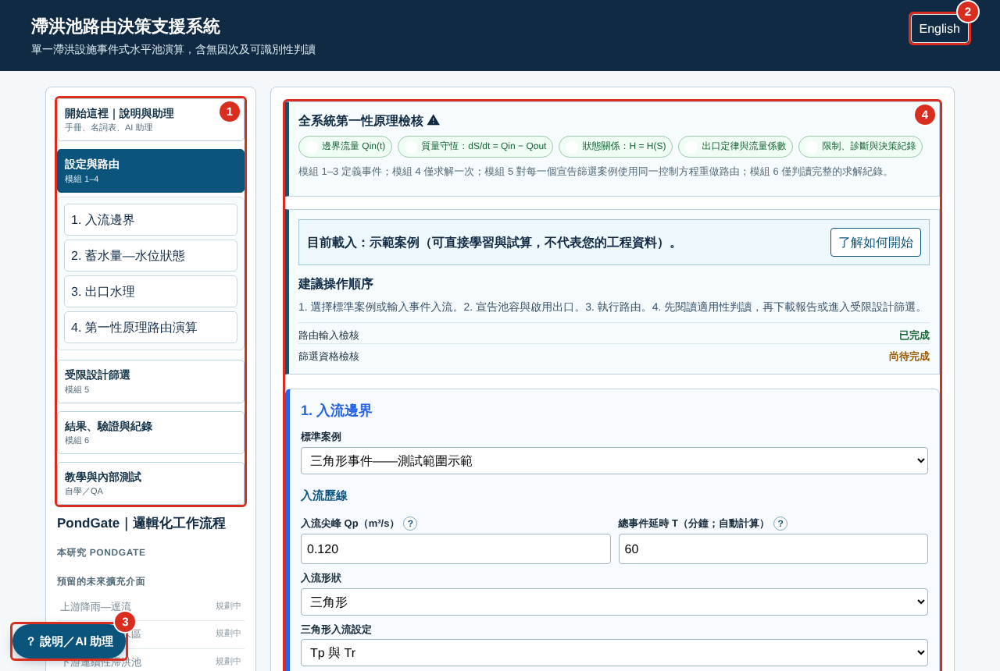

圖 2-1：PondGate 的畫面配置

1. 頁籤列：切換「開始這裡」、「設定與路由」、「受限設計篩選」、「結果、驗證與紀錄」、「教學與內部測試」五個頁面。
2. 語言切換按鈕。
3. 說明／AI 助理按鈕，隨時可以按。
4. 工作區：目前頁面的內容。

### 步驟 2-2　認識「開始這裡」頁

**操作**

1. 在頁籤列按「開始這裡｜說明與助理」。

**畫面應該出現**

- 頁面上方有一排分頁（圖中 1）。
- 「下一步」方框（圖中 2）會隨著您的操作改變內容。第一次打開時，它會說目前載入的是示範案例，可以直接按執行。
- 下方列出 1 到 5 的基本步驟（圖中 3）。

**如果不一樣**

- 找不到這一頁：它是頁籤列的第一個頁籤。

圖 2-2：「開始這裡」頁

1. 分頁：開始這裡、引導練習、使用手冊、完整版操作手冊、名詞表、AI 助理。
2. 「下一步」提示：依照目前畫面狀態，告訴您接下來該做什麼。
3. 五個基本步驟，每個都有「前往」按鈕。

### 步驟 2-3　試用 AI 助理

**操作**

1. 按左下角「？ 說明／AI 助理」。
2. 在輸入框打「Qallow 是什麼？」，按鍵盤 Enter 或「送出」。

**畫面應該出現**

- 助理回答名詞的意思，開頭是：「容許出流尖峰 Qallow…」。
- 這個助理是「離線規則式」說明：它在瀏覽器內依關鍵字與畫面狀態回答，不連線到外部 AI 服務，不會傳送任何資料，也不會改動您的輸入或替您做工程判斷。

**如果不一樣**

- 助理說它只能回答 PondGate 的問題：請改用軟體中的名詞或按鈕名稱再問一次。

圖 2-3：AI 助理（離線）

1. 常見問題按鈕，按一下就會回答。
2. 自己輸入問題的地方。
3. 問答紀錄。

### 步驟 2-4　關閉助理

**操作**

1. 按助理視窗右上角的「×」，或再按一次左下角按鈕。

**畫面應該出現**

- 助理視窗關閉，回到原本的頁面。

## 第 3 章　第一次路由：示範案例

本章用軟體內建的示範案例跑一次完整的路由，並學會讀結果。示範案例是一場三角形入流事件，流入一座 180 m² 的池，經一座 0.20 m 寬的銳頂堰排出。

### 步驟 3-1　打開「設定與路由」頁

**操作**

1. 在頁籤列按「設定與路由」。

**畫面應該出現**

- 工作區顯示模組 1「入流邊界」。頁籤下方列出 1. 入流邊界、2. 蓄水量—水位狀態、3. 出口水理、4. 第一性原理路由演算。

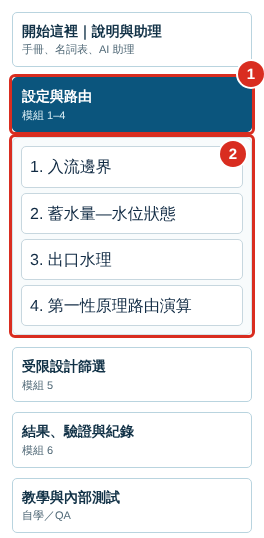

圖 3-1：「設定與路由」頁籤與模組子項目

1. 「設定與路由」頁籤。
2. 模組 1 到 4 的子項目，按一下會直接跳到該模組。

### 步驟 3-2　檢查模組 1：入流邊界

**操作**

1. 不要修改任何數值，只要對照圖中 1 到 6 的欄位。
2. 把滑鼠移到欄位名稱旁的「?」上，或按一下「?」，可以看到該欄位的說明。

**畫面應該出現**

- 標準案例＝三角形事件；入流尖峰 Qp＝0.120 m³/s；入流形狀＝三角形；Tp＝30 分鐘；Tr＝30 分鐘；總事件延時 T＝60 分鐘。
- 三角形入流的意思是：流量從 0 在 Tp 分鐘內直線上升到 Qp，再於 Tr 分鐘內直線下降回 0。

**如果不一樣**

- 數值不同：重新整理網頁回到示範值。

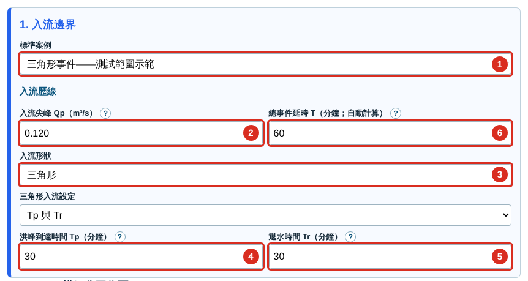

圖 3-2：模組 1 入流邊界（示範值）

1. 標準案例：目前是「三角形事件——測試範圍示範」。
2. 入流尖峰 Qp（m³/s）。
3. 入流形狀：三角形。
4. 洪峰到達時間 Tp（分鐘）。
5. 退水時間 Tr（分鐘）。
6. 總事件延時 T（自動計算 = Tp + Tr）。

### 步驟 3-3　檢查模組 2：蓄水量—水位狀態

**操作**

1. 在頁籤列按「2. 蓄水量—水位狀態」，對照圖中 1 到 4。

**畫面應該出現**

- 蓄水量表示方式＝固定平面面積，也就是池壁垂直、各水位的面積都一樣，蓄水量 S = A ×（H − Hfloor）。
- 池底高程 Hfloor＝0.00 m；平面面積 A＝180 m²；初始水位 H0＝0 m（事件開始時池是空的）。

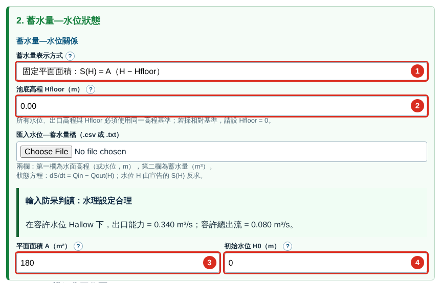

圖 3-3：模組 2 蓄水量—水位狀態（示範值）

1. 蓄水量表示方式：固定平面面積。
2. 池底高程 Hfloor（m）。
3. 平面面積 A（m²）。
4. 初始水位 H0（m）。

### 步驟 3-4　檢查模組 3：出口水理

**操作**

1. 在頁籤列按「3. 出口水理」，往下捲到「銳頂堰」，對照圖中 1 到 5。

**畫面應該出現**

- 只有「銳頂堰」被勾選；Cw＝1.70；堰寬 b＝0.20 m；堰頂高程＝0 m。
- 堰流公式是 Q = Cw × b × h^1.5，h 是水位高出堰頂的高度。堰頂高程等於池底，表示水一進池就開始經堰流出。
- 模組 3 上方還有「自由出流邊界」的勾選與紀錄欄位，第 8 章才會用到，現在先不用管。

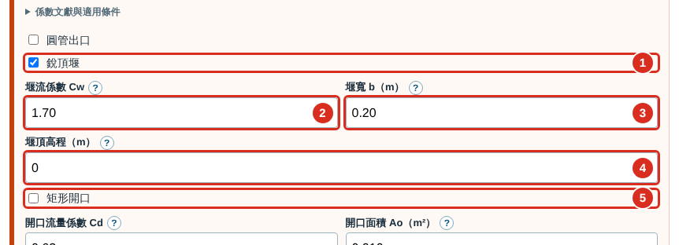

圖 3-4：模組 3 出口水理：銳頂堰（示範值）

1. 「銳頂堰」已勾選。
2. 堰流係數 Cw。
3. 堰寬 b（m）。
4. 堰頂高程（m）。
5. 「矩形開口」未勾選。

### 步驟 3-5　執行路由

**操作**

1. 在頁籤列按「4. 第一性原理路由演算」。
2. 按藍色的「執行路由與評估」按鈕（圖中 1）。

**畫面應該出現**

- 約 1 秒後，頁面自動切換到「結果、驗證與紀錄」頁（模組 6）。

**如果不一樣**

- 按鈕是灰色、按不下去：表示有欄位填錯。按鈕上方會列出要修正的欄位，詳見第 7 章。

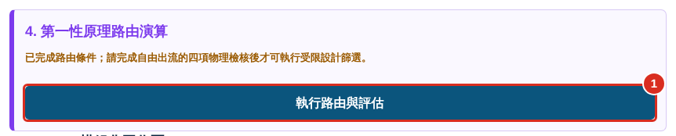

圖 3-5：模組 4 的執行按鈕

1. 「執行路由與評估」按鈕。

### 步驟 3-6　看「入流與路由出流」圖

**操作**

1. 在模組 6 找到「入流與路由出流」圖（圖中 1）。

**畫面應該出現**

- 圖中有入流（Qin）與出流（Qout）兩條曲線。入流是三角形；出流的尖峰比入流低、出現得比較晚，這就是滯洪池「削峰、延遲」的效果。
- 旁邊的「水位與蓄水量」圖（圖中 2）把水位（m）與蓄水量（m³）畫在同一個縱軸上，因為兩者數量級差很多，水位線會貼近 0。要讀水位請看下一步的結果表。

**如果不一樣**

- 圖是空白的：回到模組 4 再按一次執行。

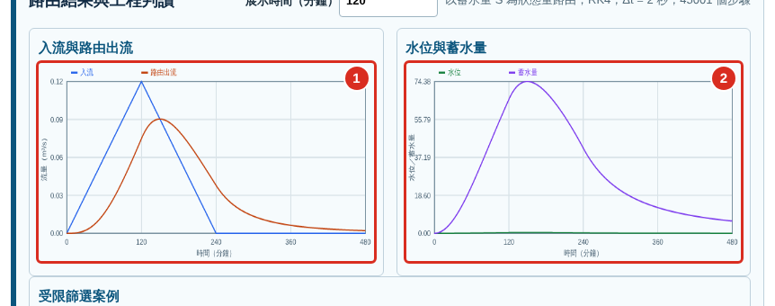

圖 3-6：路由結果圖

1. 入流與路由出流圖。
2. 水位與蓄水量圖。

### 步驟 3-7　讀結果表

**操作**

1. 往下捲到結果表。先看「質量平衡殘差 ε/Vin」（圖中 5），再看出流尖峰、尖峰比、滯洪量與最大水位。

**畫面應該出現**

- 質量平衡殘差 ε/Vin＝0.000 %。這是數值計算的守恆檢查，接近 0 表示計算本身沒有遺失或多出水量。每次讀結果都應該先看這一項。
- 出流尖峰 Qp,o＝0.0903 m³/s（入流尖峰是 0.1200 m³/s）。
- 尖峰比 RQ＝0.753，也就是出流尖峰約為入流尖峰的 75%。
- 事件新增滯洪量 ΔSmax＝74.385 m³：事件中池內最多多蓄了這麼多水。
- 最大水位 Hmax＝0.413 m：池內最高水位，要和容許水位與出水高比較。

**如果不一樣**

- ε/Vin 明顯大於 0：請記下輸入並回報，這不是正常情況。

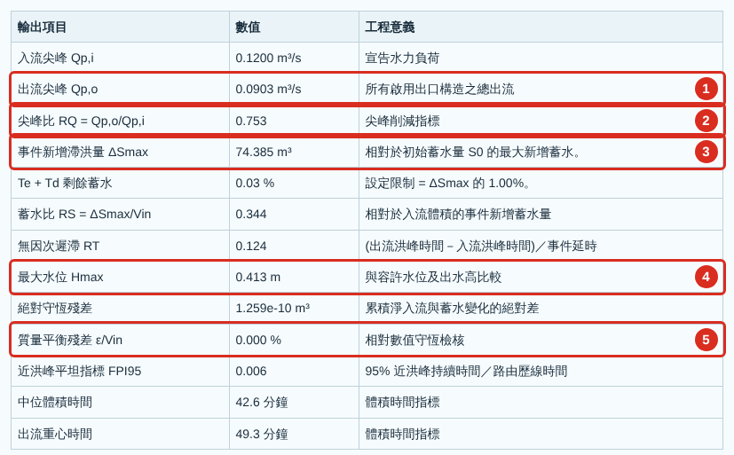

圖 3-7：結果表（示範案例）

1. 出流尖峰 Qp,o。
2. 尖峰比 RQ。
3. 事件新增滯洪量 ΔSmax。
4. 最大水位 Hmax。
5. 質量平衡殘差 ε/Vin。

### 步驟 3-8　下載可追溯紀錄

**操作**

1. 在結果表下方按「下載可追溯決策支援報告」（圖中 1）。
2. 瀏覽器若詢問是否儲存，請選擇儲存。

**畫面應該出現**

- 瀏覽器下載一個文字檔（檔名為 detention-pond-routing-run-record.txt）。
- 檔案記錄了本次所有輸入、計算設定、結果與時間序列。交作業或寫報告時，請附上這個檔案，別人就能重現您的結果。

**如果不一樣**

- 沒有出現下載：檢查瀏覽器是否封鎖下載，或在 Claude 頁面中按下確認視窗的「允許」。

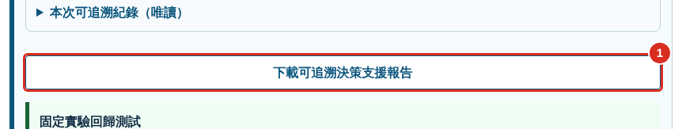

圖 3-8：下載可追溯紀錄

1. 「下載可追溯決策支援報告」按鈕。

## 第 4 章　修改輸入並比較結果

本章一次只改一個條件，觀察結果怎麼變。請準備一張紙或試算表記錄每次的結果。

### 步驟 4-1　改成較大的事件

**操作**

1. 重新整理網頁回到示範值。
2. 到模組 1，把入流尖峰 Qp 改成 0.20，洪峰到達時間 Tp 改成 20，退水時間 Tr 改成 40。

**畫面應該出現**

- 總事件延時 T 自動變成 60 分鐘（20 + 40）。

**如果不一樣**

- T 沒有變：在欄位外點一下，讓輸入生效。

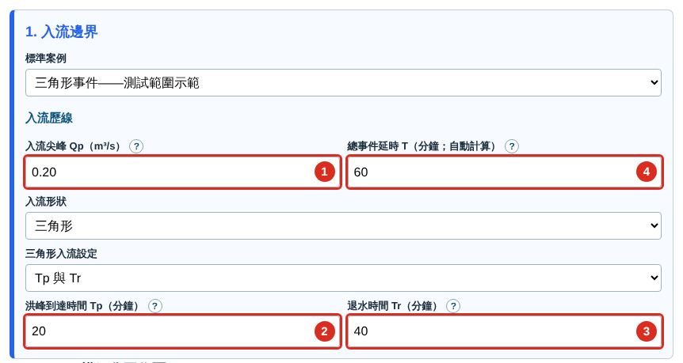

圖 4-1：修改入流條件

1. 入流尖峰 Qp 改為 0.20。
2. Tp 改為 20。
3. Tr 改為 40。
4. T 自動變成 60。

### 步驟 4-2　執行並記錄結果 A

**操作**

1. 到模組 4 按「執行路由與評估」。
2. 在結果表記下出流尖峰 Qp,o、尖峰比 RQ、ΔSmax、最大水位 Hmax。

**畫面應該出現**

- 結果 A：Qp,o＝0.1512 m³/s，RQ＝0.756，ΔSmax＝104.854 m³，Hmax＝0.583 m。

### 步驟 4-3　把池面積加大，記錄結果 B

**操作**

1. 到模組 2，把平面面積 A 從 180 改成 250。其他不動。
2. 到模組 4 按執行，記下結果 B。

**畫面應該出現**

- 結果 B：Qp,o＝0.1335 m³/s，RQ＝0.667，ΔSmax＝134.033 m³，Hmax＝0.536 m。

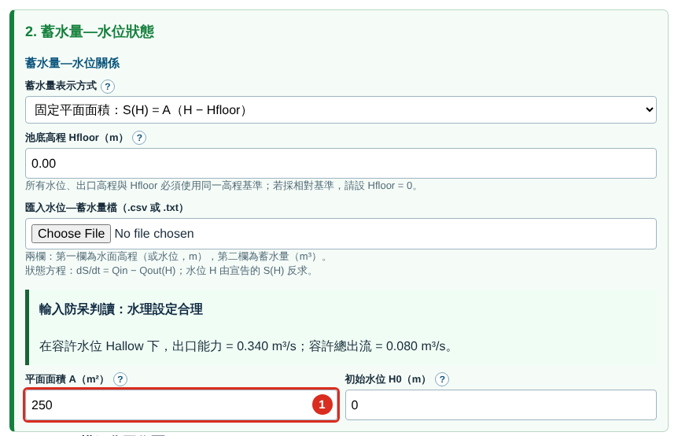

圖 4-2：把平面面積改為 250 m²

1. 平面面積 A 改為 250。

### 步驟 4-4　把堰加寬，記錄結果 C

**操作**

1. 到模組 3，把堰寬 b 從 0.20 改成 0.30（池面積維持 250）。
2. 到模組 4 按執行，記下結果 C。

**畫面應該出現**

- 結果 C：Qp,o＝0.1482 m³/s，RQ＝0.741，ΔSmax＝109.702 m³，Hmax＝0.439 m。

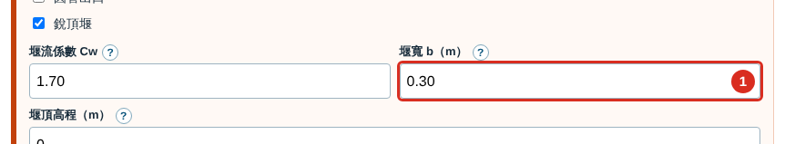

圖 4-3：把堰寬改為 0.30 m

1. 堰寬 b 改為 0.30。

### 步驟 4-5　比較三次結果

**操作**

1. 把三次結果排成表 4-1，回答下面兩個問題。

**畫面應該出現**

- A → B（池變大）：同樣的水分布在更大的面積上，水位上升較少，Hmax 下降；池能蓄更多水，出流尖峰也下降。
- B → C（堰變寬）：出口排水能力變大，水比較快流出，Hmax 下降，但出流尖峰上升、削峰效果變差。
- 結論：加大池面積可以同時降低水位與出流；加寬出口會降低水位，但增加下游的出流。設計時要在兩者之間取捨，這就是第 8 章受限設計篩選要處理的問題。

表 4-1　三次執行結果比較（本手冊製作時實際讀到的數值）

|  | 條件 | 出流尖峰 Qp,o | 尖峰比 RQ | ΔSmax | 最大水位 Hmax |
| --- | --- | --- | --- | --- | --- |
| A | Qp 0.20、A 180、b 0.20 | 0.1512 m³/s | 0.756 | 104.854 m³ | 0.583 m |
| B | 池面積改 250 | 0.1335 m³/s | 0.667 | 134.033 m³ | 0.536 m |
| C | 再把堰寬改 0.30 | 0.1482 m³/s | 0.741 | 109.702 m³ | 0.439 m |

## 第 5 章　用水位—蓄水量表描述不規則池

真實的池壁常是斜坡，不同水位的面積不同。這時要改用「水位—蓄水量表 S(H)」，逐列輸入各水位對應的蓄水量。

### 步驟 5-1　切換成水位—蓄水量表

**操作**

1. 重新整理網頁。到模組 2，「蓄水量表示方式」改選「水位—蓄水量表 S(H)」。

**畫面應該出現**

- 出現一個表格輸入框（圖中 2），預設內容是三列：0, 0／0.50, 90／1.00, 180。這剛好等於面積 180 m² 的垂直池壁。
- 「平面面積 A」與「池底高程」欄位消失，因為表格已經包含這些資訊。

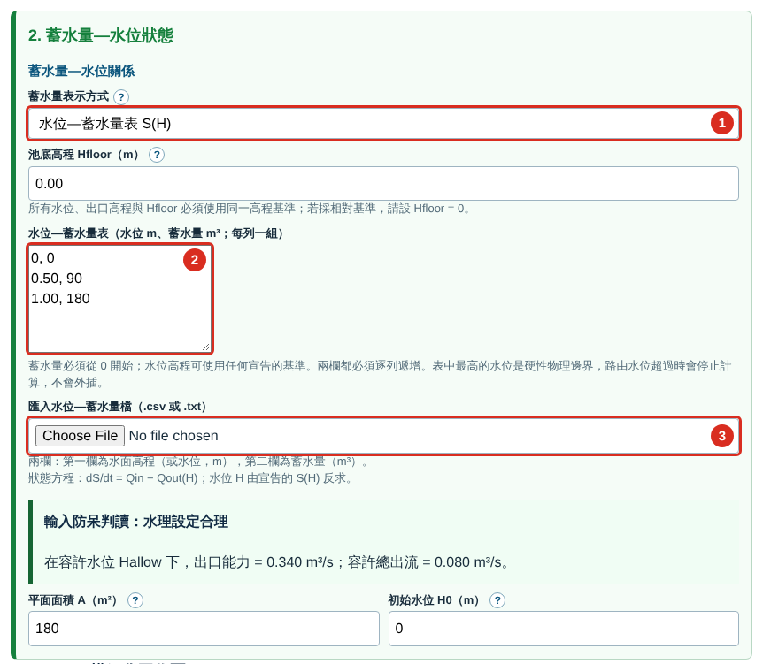

圖 5-1：水位—蓄水量表模式

1. 蓄水量表示方式改為「水位—蓄水量表 S(H)」。
2. 水位—蓄水量表，每列「水位, 蓄水量」。
3. 也可以匯入 .csv 或 .txt 檔。

### 步驟 5-2　輸入一座上寬下窄的池

**操作**

1. 把表格內容改成下面三列（每列一組，用逗號分隔）：
2. 0, 0
3. 0.50, 120
4. 1.00, 300
5. 到模組 4 按「執行路由與評估」。

**畫面應該出現**

- 這座池在 0–0.5 m 之間平均面積 240 m²，0.5–1.0 m 之間 360 m²，比示範池大。結果：Qp,o＝0.0801 m³/s，Hmax＝0.381 m，都比示範案例（第 3 章）低。

**如果不一樣**

- 出現「水位—蓄水量表必須從蓄水量 0 開始……」的紅色訊息：檢查第一列是否為 0, 0，以及水位、蓄水量是否逐列變大。

### 步驟 5-3　表格範圍不夠時會怎樣

**操作**

1. 故意把表格改成只到 0.30 m：
2. 0, 0
3. 0.15, 30
4. 0.30, 70
5. 按「執行路由與評估」。

**畫面應該出現**

- 執行被擋下，畫面停在模組 4，按鈕上方出現紅色訊息：「請先修正紅框標示的欄位，再執行路由 初始水位 H0 與參考水位 Href 必須落在宣告的水位—蓄水量表 S(H) 範圍內。請把表格延伸到更高的水位，或調整 H0、Href（模組 5）。」
- 按訊息後面的「前往紅框欄位」，會跳到模組 2 的表格，表格欄位有紅框。
- PondGate 不會把表格以外的部分自行外插（猜測），因為那會產生沒有依據的結果。
- 如果此時切到「結果、驗證與紀錄」頁，結果表上方會有紅色提醒：下方圖表與結果是上一次成功執行的結果，不能引用。

**如果不一樣**

- 解決方法：把表格延伸到比可能的最高水位更高（並高於模組 5 的參考水位 Href＝1.00 m），例如加入「0.60, 160」與「1.00, 300」兩列，再執行一次。

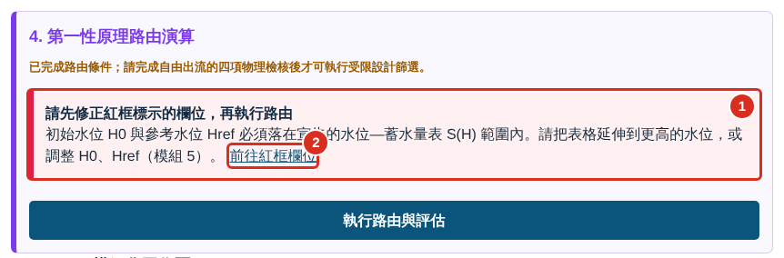

圖 5-2：表格範圍不足，執行被擋下

1. 紅色訊息：說明為什麼這次執行被擋下。
2. 「前往紅框欄位」按鈕。

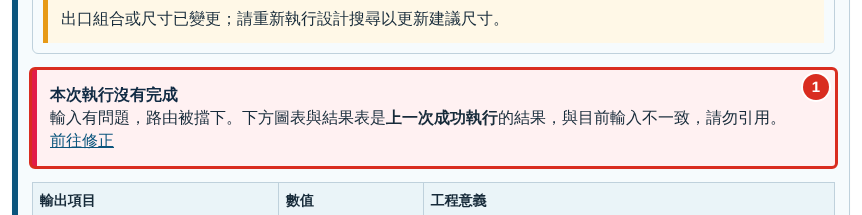

圖 5-3：結果頁的提醒

1. 提醒：下方是上一次成功執行的結果，與目前輸入不一致。

### 步驟 5-4　從檔案匯入表格

**操作**

1. 用記事本或 Excel 建立一個檔案，第一欄是水位（m），第二欄是蓄水量（m³），每列一組，例如：
2. 0,0
3. 0.5,120
4. 1.0,300
5. 存成 .csv 或 .txt 檔。第一列直接放數字，不要放欄名文字。
6. 在模組 2 按「匯入水位—蓄水量檔」旁的選擇檔案按鈕，選取這個檔案。

**畫面應該出現**

- 檔案內容會填進表格，並自動切換成「水位—蓄水量表」模式。

**如果不一樣**

- 匯入後執行出現「必須從蓄水量 0 開始……」的訊息：通常是第一列放了欄名（例如「水位,蓄水量」），請刪除那一列。

### 步驟 5-5　改回固定平面面積

**操作**

1. 「蓄水量表示方式」改回「固定平面面積」，或重新整理網頁。

**畫面應該出現**

- 平面面積 A 與池底高程欄位重新出現。

## 第 6 章　長延時事件與時間判讀

入流持續很久、尖峰很平的事件，出流尖峰也會很平。這時「尖峰發生在第幾分鐘」不是一個穩定的數字，報告時要改用體積時間指標。

### 步驟 6-1　載入長延時事件

**操作**

1. 重新整理網頁。到模組 1，「標準案例」改選「長延時事件——時間判讀驗證示範」。

**畫面應該出現**

- 入流形狀自動變為長延時平頂：上升 24 分鐘、平頂 72 分鐘、退水 24 分鐘，總事件延時 120 分鐘。尖峰流量仍是 0.120 m³/s。

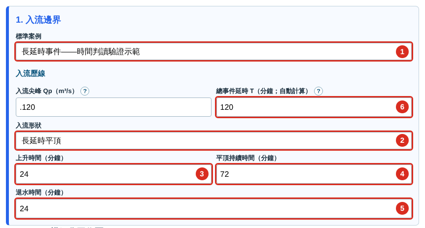

圖 6-1：長延時事件的入流設定

1. 標準案例改選「長延時事件」。
2. 入流形狀自動變為「長延時平頂」。
3. 上升時間。
4. 平頂持續時間。
5. 退水時間。
6. 總事件延時。

### 步驟 6-2　執行並讀時間指標

**操作**

1. 到模組 4 按「執行路由與評估」。
2. 在結果表找到尖峰比 RQ、近洪峰平坦指標 FPI95、中位體積時間與出流重心時間。

**畫面應該出現**

- 尖峰比 RQ＝1.000：平頂持續夠久，池最後被填到出流等於入流，幾乎沒有削峰。這說明滯洪池對長延時事件的削峰能力有限。
- FPI95＝0.036；中位體積時間＝72.5 分鐘；出流重心時間＝74.6 分鐘。
- 中位體積時間是累積出流量達到一半的時間；出流重心時間是出流量的時間加權平均。這兩個指標用整場事件的水量計算，不會因為尖峰附近的小起伏而跳動。

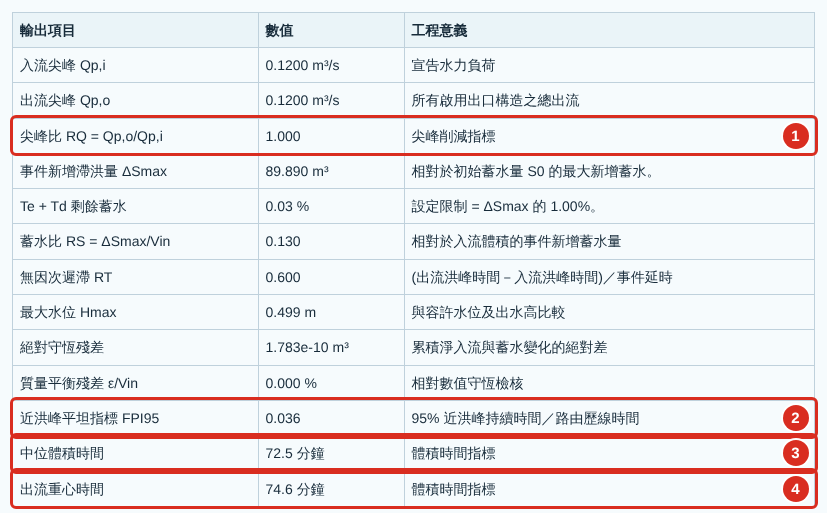

圖 6-2：長延時事件的結果表

1. 尖峰比 RQ。
2. 近洪峰平坦指標 FPI95。
3. 中位體積時間。
4. 出流重心時間。

### 步驟 6-3　看時間判讀提醒

**操作**

1. 依第 8 章步驟 8-1、8-2，勾選自由出流並填寫兩項紀錄（練習用的教學假設）。
2. 再按一次「執行路由與評估」，在結果表下方找黃色提醒框。

**畫面應該出現**

- 提醒框顯示：「請檢核時間判讀 出流歷線有一段寬平的近洪峰區間。尖峰流量與體積可能穩定，但不可只用單一時點的尖峰時間作協調或預警判斷；請同時報告區間型與體積型時間指標。」
- 沒有完成自由出流設定時，同一個位置會優先提醒「自由出流證據尚未完整」，所以要先完成設定才會看到這段時間判讀提醒。

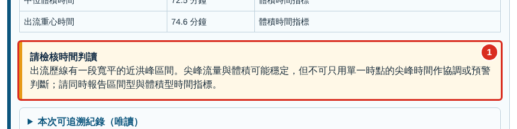

圖 6-3：長延時事件的時間判讀提醒

1. 時間判讀提醒。

### 步驟 6-4　判讀原則

**操作**

1. 閱讀下面的原則，並回答章末問題。

**畫面應該出現**

- 洪峰很平時，「出流尖峰時間」只要有一點點數值擾動就可能前後移動很多，不適合單獨報告。
- 報告時應同時列出 FPI95 與中位體積時間或出流重心時間。FPI95 越大表示尖峰越平。長延時事件，或 FPI95 大於 0.12 時，PondGate 會提醒您檢核時間判讀。
- 問題：洪峰很平時，報告的時間應優先使用哪一種？答案：體積時間指標（中位體積時間、出流重心時間），並附上 FPI95。

## 第 7 章　找出並修正錯誤輸入

輸入不合理時，PondGate 不會算出一個錯誤的結果，而是擋下執行並告訴您哪裡要改。本章故意輸入錯誤，練習看懂提示。

### 步驟 7-1　把入流尖峰改成 0

**操作**

1. 重新整理網頁。到模組 1，把入流尖峰 Qp 改成 0。
2. 到模組 4 看執行按鈕。

**畫面應該出現**

- 「執行路由與評估」按鈕變成灰色，按不下去（圖中 2）。
- 按鈕上方列出要修正的欄位（圖中 1）：「需要修正的欄位 點欄位名稱即可跳過去（紅框標示）： 入流尖峰 Qp 必須大於 0」。

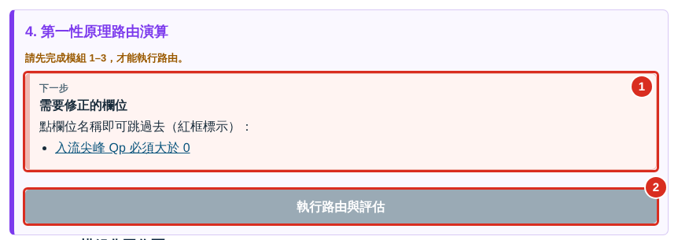

圖 7-1：執行按鈕被擋下時的提示

1. 需要修正的欄位清單。
2. 執行按鈕變成灰色。

### 步驟 7-2　點清單跳回欄位

**操作**

1. 按清單中的「入流尖峰 Qp 必須大於 0」。

**畫面應該出現**

- 畫面跳回模組 1，Qp 欄位有紅色外框。

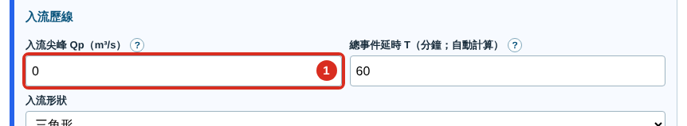

圖 7-2：有問題的欄位以紅框標示

1. 有問題的欄位以紅框標示。

### 步驟 7-3　修正後恢復

**操作**

1. 把 Qp 改回 0.120。

**畫面應該出現**

- 紅框與清單消失，執行按鈕恢復藍色，可以按了。

### 步驟 7-4　再試一個：初始水位低於池底

**操作**

1. 到模組 2，把初始水位 H0 改成 −0.1（比池底 0.00 還低）。
2. 看模組 4 的清單，然後把 H0 改回 0。

**畫面應該出現**

- 清單顯示：「下一步需要修正的欄位點欄位名稱即可跳過去（紅框標示）：初始水位 H0 不可低於池底高程 Hfloor」。改回 0 後恢復正常。

### 步驟 7-5　常見的錯誤輸入

**操作**

1. 參考附錄 B 的錯誤訊息表。

**畫面應該出現**

- 常見錯誤包括：流量或時間填 0 或負數、初始水位低於池底、堰寬或開口面積為 0、容許水位低於初始水位、水位—蓄水量表範圍不足或第一列放了欄名。

## 第 8 章　受限設計篩選：找到可行解

前幾章是「給定池與出口，算水位與出流」。本章反過來：給定下游容許的最大出流 Qallow 與池內容許的最高水位 Hallow，讓 PondGate 在宣告的範圍內試算許多池面積與堰寬組合，找出符合限制的案例。

受限篩選只在出口是「已確認自由出流的單一堰或單一矩形開口」時才能正式執行。自由出流的意思是：出口下游的水位不會影響出流量。因此必須先完成四項檢核與兩項紀錄。本章的檢核與紀錄都是「教學假設（僅供練習）」。

### 步驟 8-1　勾選自由出流邊界與四項檢核

**操作**

1. 重新整理網頁。到模組 3，勾選「已確認自由出流邊界」（圖中 1）。
2. 再勾選下方四項檢核（圖中 2 到 5）。

**畫面應該出現**

- 五個方框都打勾。

**如果不一樣**

- 實際工作時，只有在有圖說、現地檢查或水理計算支持時才能勾選。

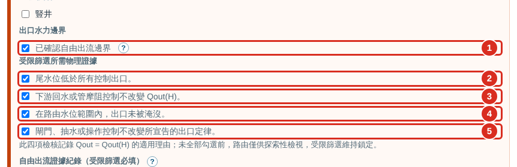

圖 8-1：自由出流邊界與四項檢核

1. 「已確認自由出流邊界」。
2. 尾水位低於所有控制出口。
3. 下游回水或管摩阻不改變 Qout(H)。
4. 出口未被淹沒。
5. 閘門、抽水或操作控制不改變出口定律。

### 步驟 8-2　填寫兩項紀錄

**操作**

1. 在「自由出流證據紀錄」填入：
2. 教學假設（僅供練習）：單一銳頂堰自由出流，不受尾水、回水、淹沒或操作控制影響。
3. 在「篩選限制依據」填入：
4. 教學假設（僅供練習）：Qallow = 0.080 m³/s、Hallow = 1.00 m。

**畫面應該出現**

- 兩個欄位都有文字。這兩段文字會寫進下載的報告，讓別人知道判斷依據。

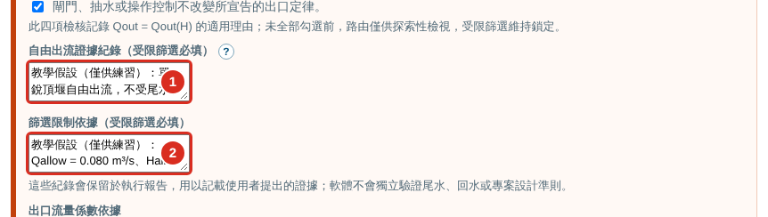

圖 8-2：兩項必填紀錄

1. 自由出流證據紀錄。
2. 篩選限制依據。

### 步驟 8-3　先執行一次路由

**操作**

1. 到模組 4 按「執行路由與評估」，讓結果與目前輸入一致。

**畫面應該出現**

- 頁面切到模組 6，顯示示範案例的結果（與第 3 章相同）。

### 步驟 8-4　設定限制條件

**操作**

1. 在頁籤列按「受限設計篩選」（模組 5）。
2. 確認：容許出流尖峰＝0.080 m³/s；容許水位＝1.00 m；Href＝1.00 m；最長排空時間 Td＝24 小時；容許殘留＝1 %。

**畫面應該出現**

- Qallow 是下游能接受的最大出流；Hallow 是池內不能超過的最高水位。兩者都應來自法規或設計準則，不能為了得到結果而任意放寬。
- Td 與殘留百分比要求事件結束後 Td 小時內，池要排到只剩很少的事件蓄水，以準備下一場雨。

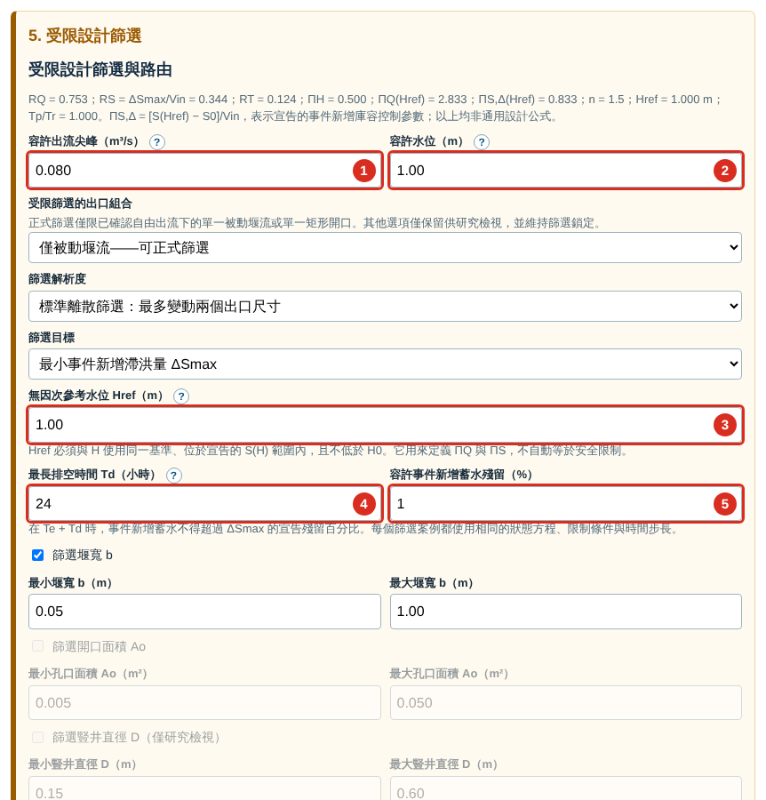

圖 8-3：模組 5 的限制條件

1. 容許出流尖峰 Qallow。
2. 容許水位 Hallow。
3. 無因次參考水位 Href。
4. 最長排空時間 Td。
5. 容許事件新增蓄水殘留。

### 步驟 8-5　設定出口組合與搜尋範圍

**操作**

1. 確認：出口組合＝「僅被動堰流——可正式篩選」；篩選解析度＝標準離散篩選；篩選目標＝最小事件新增滯洪量 ΔSmax；堰寬範圍 0.05 到 1.00 m。

**畫面應該出現**

- 軟體會在這個範圍內試算許多池面積與堰寬組合，每一個都用同一個 RK4 演算重新計算。

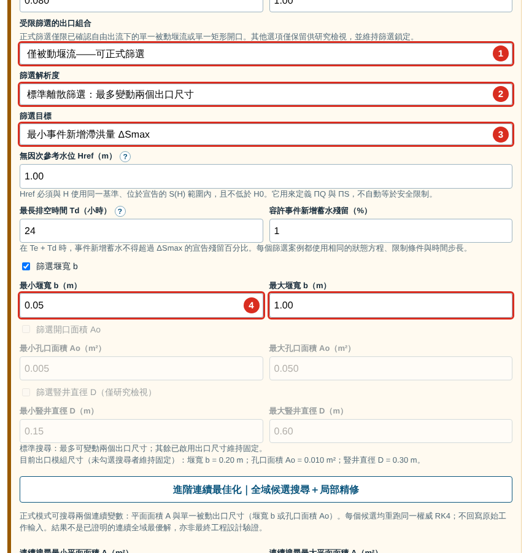

圖 8-4：出口組合、目標與搜尋範圍

1. 受限篩選的出口組合：僅被動堰流。
2. 篩選解析度。
3. 篩選目標。
4. 最大堰寬。
5. 「執行受限設計篩選」按鈕。

### 步驟 8-6　執行受限設計篩選

**操作**

1. 按「執行受限設計篩選」，等待約 5 到 10 秒。

**畫面應該出現**

- 頁面自動切到「結果、驗證與紀錄」頁，顯示「選定可行受限篩選案例——已完成路由」。
- 選定池面積 A＝460 m²、堰寬 b＝0.53 m；出流尖峰／容許值＝0.0798 / 0.0800 m³/s；最高水位／容許值＝0.200 / 1.000 m；排空殘留＝0.07 / 1.00%。
- 每一項都在限制之內。

**如果不一樣**

- 按鈕是灰色：自由出流的勾選或兩項紀錄還沒完成，或出口組合不是單一堰或單一開口。按鈕下方會說明原因並有「前往修正」。

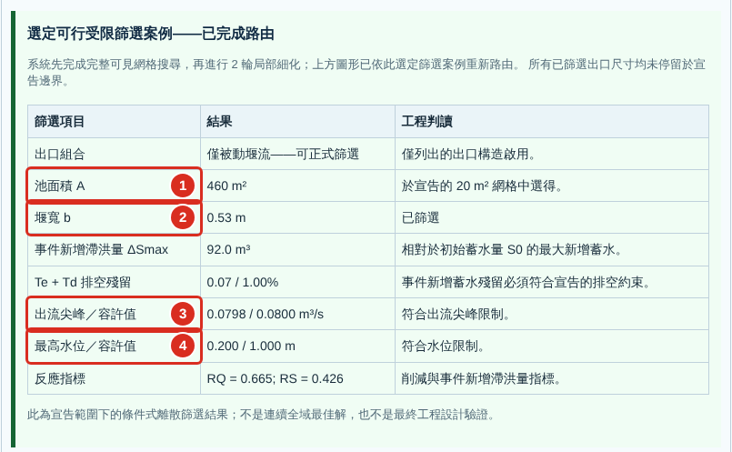

圖 8-5：受限篩選結果（可行）

1. 選定的池面積。
2. 選定的堰寬。
3. 出流尖峰與容許值。
4. 最高水位與容許值。

### 步驟 8-7　讀三步判讀

**操作**

1. 在篩選結果下方找到「受限篩選／最佳化結果驗證｜三步判讀」。

**畫面應該出現**

- 步驟 1：篩選計算狀態＝「通過｜受限篩選完成」。
- 步驟 2：出口型式、最高水位、最大出流、排空殘留與 S(H) 邊界、自由出流四項佐證，都顯示「通過」。
- 步驟 3：目前結果符合已宣告條件；仍須完成最終工程設計驗證。

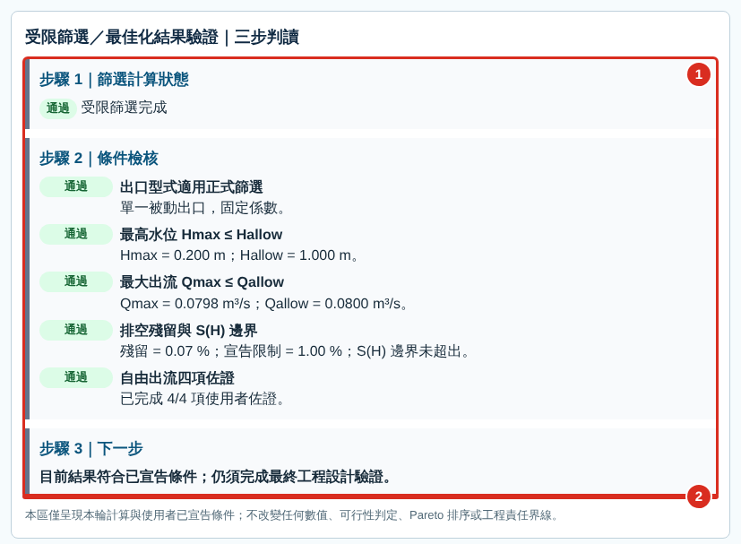

圖 8-6：三步判讀（可行）

1. 步驟 1 到 3。
2. 各項條件的檢核結果。

### 步驟 8-8　注意：輸入已換成選定值

**操作**

1. 回到模組 2 與模組 3，看平面面積 A 與堰寬 b。

**畫面應該出現**

- 篩選後，模組 2 的平面面積由 180 變成 460 m²，模組 3 的堰寬由 0.20 變成 0.525 m。上方圖形與結果表顯示的是選定案例的路由結果。想回到原本的示範值，請重新整理網頁。

### 步驟 8-9　下載報告

**操作**

1. 按「下載可追溯決策支援報告」。

**畫面應該出現**

- 報告包含限制條件、自由出流紀錄、篩選結果與三步判讀。

## 第 9 章　無可行解：讀懂「阻擋」

如果限制太嚴，在宣告的範圍內可能找不到任何符合條件的組合。PondGate 會明確顯示「阻擋」，並指出是哪一項限制造成的，絕不會顯示「通過」。

### 步驟 9-1　把容許出流改得很嚴

**操作**

1. 重新整理網頁，依第 8 章步驟 8-1 到 8-3 完成自由出流勾選、兩項紀錄並執行一次路由。
2. 到模組 5，把容許出流尖峰 Qallow 改成 0.010。

**畫面應該出現**

- Qallow 欄位顯示 0.010。

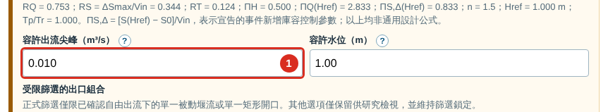

圖 9-1：把 Qallow 改為 0.010

1. 容許出流尖峰改為 0.010。

### 步驟 9-2　執行篩選，看到阻擋

**操作**

1. 按「執行受限設計篩選」。

**畫面應該出現**

- 篩選結果顯示：「阻擋：在宣告的物理邊界與離散篩選範圍內找不到可行篩選案例。主導限制：出流尖峰限制、最高水位限制、排空殘留限制。請僅依工程依據調整池面積、堰寬或開口面積；不得任意放寬 Qallow 或 Hallow。」
- 三步判讀的步驟 1 顯示「阻擋｜無可行解」，步驟 3 列出主導限制與「前往修正」連結。

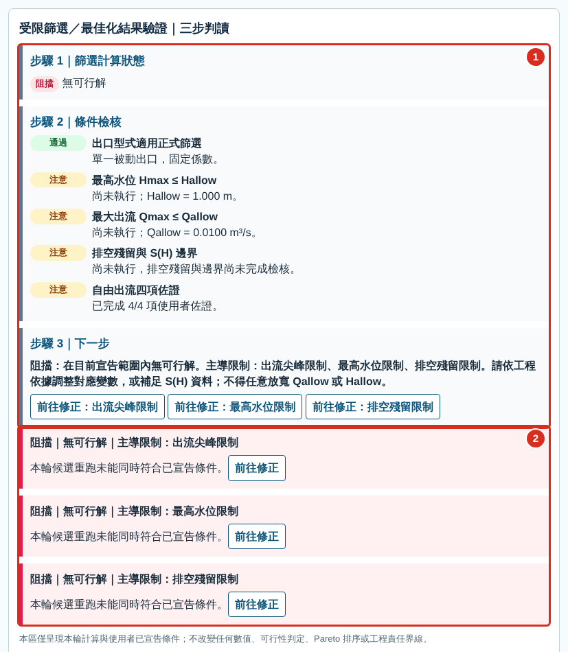

圖 9-2：無可行解時的三步判讀

1. 步驟 1 顯示「阻擋｜無可行解」，步驟 3 列出主導限制。
2. 每一項主導限制都有「前往修正」。

### 步驟 9-3　正確的處理方式

**操作**

1. 閱讀下面的原則，然後把 Qallow 改回 0.080。

**畫面應該出現**

- 不可以為了得到結果而放寬 Qallow 或 Hallow，因為它們來自法規或設計準則。
- 可以做的是：依工程依據調整池面積、出口尺寸，或擴大有依據的搜尋範圍；或補足 S(H) 資料。
- 「阻擋」本身是有用的結果：它告訴您在目前條件下，這個設計方向做不到。

## 第 10 章　研究檢視模式：哪些出口不能正式篩選

PondGate 的正式受限篩選只驗證了「單一堰」或「單一矩形開口」。若同時使用多種出口，或使用豎井、圓管、水位相關係數表，路由仍可以算，但受限篩選會被鎖定，只能作研究檢視。

### 步驟 10-1　加入矩形開口，變成複合出口

**操作**

1. 重新整理網頁，依第 8 章完成自由出流勾選與兩項紀錄。
2. 到模組 3，在銳頂堰之外再勾選「矩形開口」。

**畫面應該出現**

- 出現矩形開口的欄位：流量係數 Cd、開口面積 Ao、開口高度、開口底高程。

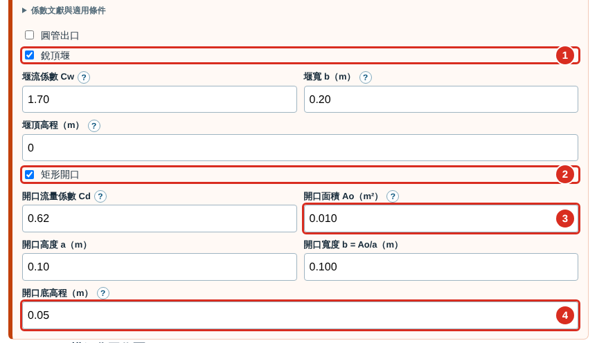

圖 10-1：堰流＋矩形開口的複合出口

1. 銳頂堰（已勾選）。
2. 矩形開口（新勾選）。
3. 開口面積 Ao。
4. 開口底高程。

### 步驟 10-2　路由仍可以執行

**操作**

1. 到模組 4 按「執行路由與評估」。

**畫面應該出現**

- 路由正常完成：Qp,o＝0.0927 m³/s，Hmax＝0.378 m。結果可以看，但出流量是堰與開口的總和。

### 步驟 10-3　受限篩選被鎖定

**操作**

1. 到模組 5，往下捲到「執行受限設計篩選」按鈕。

**畫面應該出現**

- 按鈕下方說明「此出口型式不適用正式受限設計篩選；請使用單一被動堰流或單一矩形開口」，並有「前往修正」。
- 也可以問 AI 助理「受限篩選為什麼鎖定？」，它會列出原因。

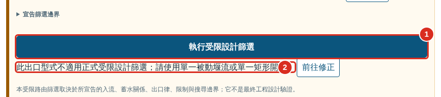

圖 10-2：複合出口時受限篩選被鎖定

1. 「執行受限設計篩選」按鈕被鎖定。
2. 鎖定原因與「前往修正」。

### 步驟 10-4　回到單一出口

**操作**

1. 到模組 3，取消勾選「矩形開口」。

**畫面應該出現**

- 鎖定原因消失，受限篩選可以再次執行。

## 第 11 章　進階連續最佳化（選讀）

第 8 章的受限篩選在固定的網格上試算。進階連續最佳化則在面積 A 與堰寬 b 的連續範圍內搜尋，同時考慮兩個目標（滯洪量與水位），列出一組互相取捨的方案（Pareto 方案）。

### 步驟 11-1　執行進階連續最佳化

**操作**

1. 完成第 8 章的自由出流勾選、兩項紀錄與一次路由。
2. 到模組 5，按「進階連續最佳化｜全域候選搜尋＋局部精修」，等待約 20 秒。

**畫面應該出現**

- 結果顯示：「同一權威 RK4 路由核心共評估 220 個候選值；147 個為非劣可行方案。第一個 Pareto 方案已選定並顯示完整路由結果。結果是全域候選搜尋結果，不是已證明的連續全域最優解，也不是最終工程設計驗證。」
- 表中每一列是一個可行方案：面積、堰寬、ΔSmax、Hmax、Qmax 與離限制還有多少餘裕。沒有一個方案在所有目標上都最好，要由設計者依工程判斷取捨。

**如果不一樣**

- 這仍不是已證明的全域最佳解，也不是最終工程設計。

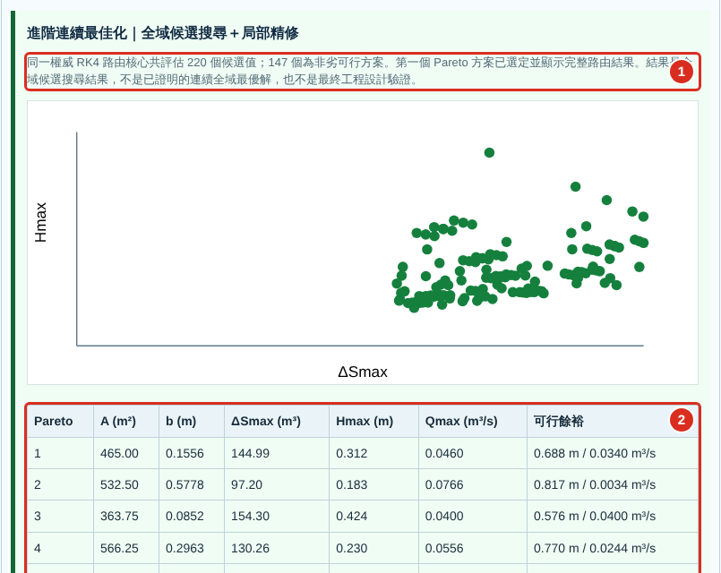

圖 11-1：進階連續最佳化的 Pareto 方案

1. 搜尋摘要。
2. Pareto 方案表。

## 第 12 章　外部模型交叉驗算（選讀）

如果您會使用 HEC-HMS 或 SWMM，可以用同樣的入流、蓄水關係與出口建立模型，把結果匯入 PondGate 比較。這是數值實作的交叉檢查，不是現地驗證。

### 步驟 12-1　認識交叉驗算區

**操作**

1. 先執行一次路由。在「結果、驗證與紀錄」頁往下捲到「外部模型交叉驗算」。

**畫面應該出現**

- 「PondGate 參考歷線」可選目前互動路由結果，或四組公開基準案例 A-005 到 D-005。
- CSV 第一列必須是欄名，至少要有 time_s（秒）與 outflow_m3_s（m³/s）兩欄；完整比較還需要 incremental_storage_m3。按「下載外部結果 CSV 範本」可以看到格式。
- 匯入外部模型的實際輸出檔後，按「比較外部結果」。

**如果不一樣**

- 不要匯入入流檔、模型設定檔或 PondGate 自己的輸出檔。

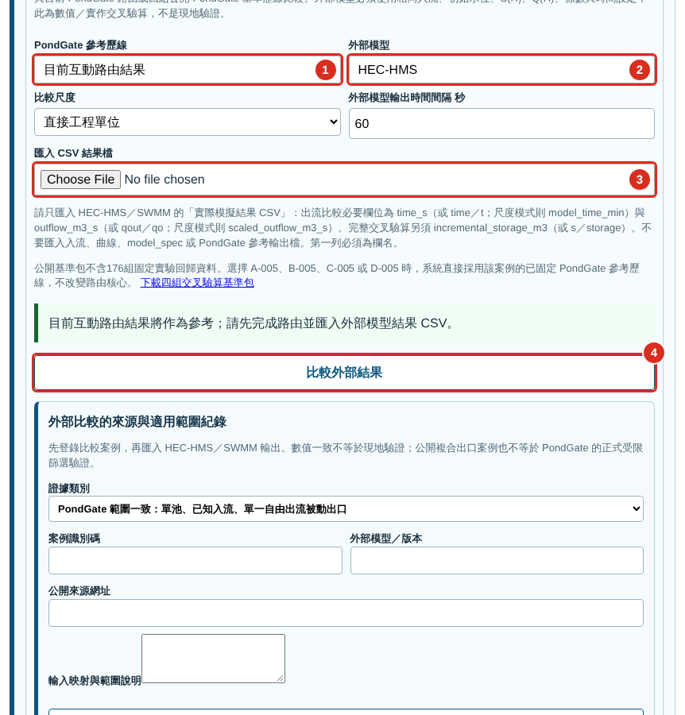

圖 12-1：外部模型交叉驗算區

1. PondGate 參考歷線。
2. 外部模型：HEC-HMS 或 SWMM。
3. 匯入外部模型結果 CSV。
4. 「比較外部結果」按鈕。
5. 下載 CSV 範本（只示範欄名）。

### 步驟 12-2　看一個已完成的三引擎比較

**操作**

1. 在頁籤列按「教學與內部測試」，找到「E‑W1 A‑005 外部交叉驗算基準」。
2. 按「執行 E‑W1 A‑005 基準 RK4」。

**畫面應該出現**

- 畫面自動切到「結果、驗證與紀錄」頁，在「E‑W1 A‑005 比較結果」顯示「本輪基準完成：3910 筆真實 RK4 結果；可匯出 comparison_results CSV。」。這個公開案例已保存 EPA SWMM 5.2.4 與 HEC‑HMS 4.13 的結果，可以看到三個引擎在同一案例下的比較。
- 這個案例是論文用的數值驗證案例，不是工程設計案例。

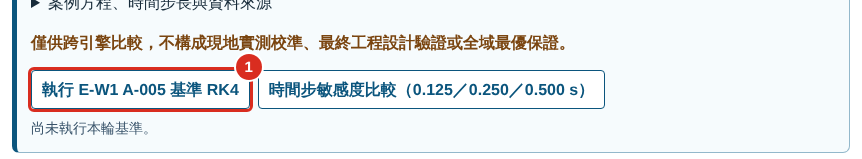

圖 12-2：E‑W1 A‑005 基準案例

1. 「執行 E‑W1 A‑005 基準 RK4」按鈕。

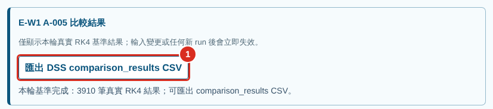

圖 12-3：E‑W1 A‑005 比較結果（結果、驗證與紀錄頁）

1. 匯出比較結果 CSV。

## 第 13 章　引導練習、教學案例與名詞表

PondGate 內建 7 個引導練習。練習會在畫面右上角顯示步驟，每一步做完會自動打勾。

### 步驟 13-1　打開引導練習清單

**操作**

1. 在「開始這裡」頁按「引導練習」分頁。

**畫面應該出現**

- 列出練習 1 到 7，每個都有目標說明與「開始」按鈕。做完的練習會顯示「完成」。

圖 13-1：引導練習清單

1. 「引導練習」分頁。
2. 七個練習，按「開始」即可進行。

### 步驟 13-2　進行一個練習

**操作**

1. 按練習 2 的「開始」。軟體會詢問是否暫時換成練習輸入，按「確定」。
2. 依面板指示操作。不會的時候按「帶我去」跳到欄位，或按「示範這一步」讓軟體示範。

**畫面應該出現**

- 畫面右上角出現練習面板，顯示目前步驟。做對時步驟會變成綠色並自動前進。
- 練習結束時可以還原您原本的輸入。

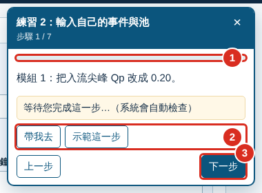

圖 13-2：練習面板

1. 進度條。
2. 「帶我去」、「示範這一步」等按鈕。
3. 下一步。

### 步驟 13-3　使用名詞表

**操作**

1. 按「名詞表」分頁，在搜尋框輸入「自由出流」。

**畫面應該出現**

- 列出相關名詞與說明。按「看欄位」會跳到該欄位。

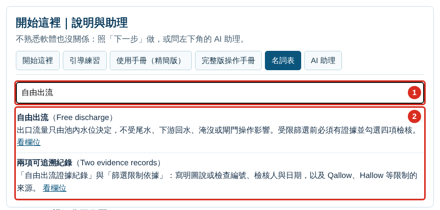

圖 13-3：名詞表

1. 輸入名詞搜尋。
2. 搜尋結果，按「看欄位」會跳到對應欄位。

### 步驟 13-4　教學案例（教學與內部測試頁）

**操作**

1. 在頁籤列按「教學與內部測試」，找到「教學輔助｜四步自學與立即檢核」。
2. 按「載入可執行受限篩選教學案例」，軟體會先保存您目前的輸入，再載入一組可以直接執行受限篩選的教學資料。用完後按「還原先前案例」。

**畫面應該出現**

- 下方有四個學習步驟與快速自我檢核題，每題約 30 秒。

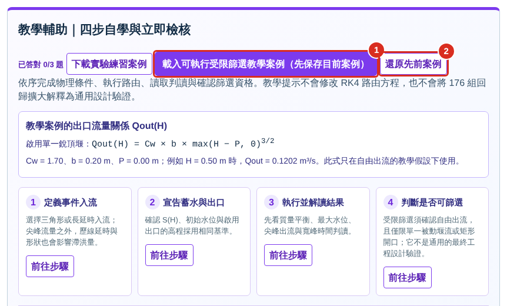

圖 13-4：教學輔助區

1. 載入可執行受限篩選的教學案例（會先保存目前案例）。
2. 還原先前案例。

## 附錄 A　名詞速查

| 名詞 | 說明 |
| --- | --- |
| 入流尖峰 Qp | 入流歷線的最大流量（m³/s），必須大於 0。 |
| 洪峰到達時間 Tp | 三角形入流從 0 上升到尖峰所需的時間（分鐘）。 |
| 退水時間 Tr | 三角形入流從尖峰下降到 0 所需的時間（分鐘）。 |
| 總事件延時 T | 入流歷線的總長度（分鐘），由各段時間自動相加，不能直接輸入。 |
| 蓄水量—水位關係 S(H) | 池中水位 H 與蓄水量 S 的對應關係。固定面積時 S = A ×（H − Hfloor）。 |
| 平面面積 A | 固定面積模式下的池面積（m²），必須大於 0。 |
| 池底高程 Hfloor | 池底的高程（m）。所有水位與出口高程都要與它使用同一個基準。 |
| 初始水位 H0 | 事件開始時的池內水位（m），不可低於 Hfloor。 |
| 高程基準 | 量測高程的共同零點。池底、水位、堰頂、開口底都要用同一個基準，否則結果錯誤。 |
| 堰流係數 Cw | 銳頂堰公式 Q = Cw × b ×（H − P）^1.5 中的係數。預設 1.70 只供初步篩選。 |
| 堰寬 b | 銳頂堰的溢流寬度（m）。 |
| 堰頂高程 P | 水位超過此高程才開始溢流（m）。 |
| 流量係數 Cd | 矩形開口公式 Q = Cd × Ao × √(2g(H − 開口底高程)) 中的係數。預設 0.62。 |
| 開口面積 Ao | 矩形開口的斷面積（m²）＝ 高度 a × 寬度 b。 |
| 開口底高程 | 矩形開口的下緣高程（m），水位高於此值才出流。 |
| 研究檢視 | 豎井、圓管、係數表或複合出口的設定。可以路由看結果，但受限設計篩選鎖定，須另行獨立驗證。 |
| 自由出流 | 出口流量只由池內水位決定，不受尾水、下游回水、淹沒或閘門操作影響。受限篩選前必須有證據並勾選四項檢核。 |
| 兩項可追溯紀錄 | 「自由出流證據紀錄」與「篩選限制依據」：寫明圖說或檢查編號、檢核人與日期，以及 Qallow、Hallow 等限制的來源。 |
| RK4 | 四階 Runge–Kutta 法，用固定時間步長 Δt = 2 秒逐步解 dS/dt = Qin − Qout。 |
| 質量平衡殘差 ε/Vin | 累積淨入流與蓄水變化的差，除以入流總體積。應接近 0 %；超過 0.5 % 不可使用結果。 |
| 尖峰比 RQ | RQ = 出流尖峰 ÷ 入流尖峰。越小代表削峰越多。 |
| 事件新增滯洪量 ΔSmax | 事件期間相對初始蓄水量的最大新增蓄水（m³）。 |
| 蓄水比 RS | RS = ΔSmax ÷ 入流總體積 Vin。 |
| 無因次遲滯 RT | RT =（出流尖峰時間 − 入流尖峰時間）÷ 事件延時。 |
| 最高水位 Hmax | 事件中池內最高水位（m），應與容許水位 Hallow 及出水高比較。 |
| 近洪峰平坦指標 FPI95 | 出流在 95 % 尖峰以上的持續時間占路由時間的比例。數值大代表峰很平，單一峰值時間不可靠。 |
| 容許出流尖峰 Qallow | 受限篩選中出流尖峰的上限（m³/s），應依法規或設計準則填寫。 |
| 容許水位 Hallow | 受限篩選中最高水位的上限（m），不可低於 H0。 |
| 最長排空時間 Td 與殘留百分比 | 在事件結束時間 Te 再加 Td 時，事件新增蓄水不得超過 ΔSmax 的宣告百分比。 |
| 參考水位 Href | 只用來定義無因次參數 ΠQ、ΠS 的水位（m），不自動等於安全限制。 |
| 無因次參數 ΠH、ΠQ、ΠS | 把水位、出流能力與庫容以入流尺度正規化的比值，用於比較不同案例；不是通用設計公式。 |
| 受限設計篩選 | 在宣告的限制與搜尋邊界內，逐一重跑路由找出可行的池面積與出口尺寸。結果不是最終設計。 |
| 連續最佳化 | 在面積上下限之間連續搜尋面積 A 與一個出口尺寸，再局部精修；不是已證明的全域最佳解。 |
| 阻擋／無可行解 | 在目前的限制與邊界內，沒有任何候選能同時符合所有條件。系統顯示主導限制與修正方向，不會顯示「通過」。 |
| 數值一致性 | 用相同輸入與物理設定時，PondGate 與 HEC-HMS／SWMM 的計算結果相近。不代表現地校準或普遍驗證。 |
| 176 組回歸測試 | 用 176 組實驗室案例（352 條原始歷線）檢查每次發版的 RK4 核心結果不變；尖峰流量 MARE：A 2.924 %、B 2.954 %、C 4.104 %、D 4.649 %。 |

## 附錄 B　錯誤訊息與處理

表 B-1　常見錯誤訊息

| 訊息（出現在執行按鈕上方） | 原因 | 怎麼改 |
| --- | --- | --- |
| 入流尖峰 Qp 必須大於 0 | Qp 為 0、負數或空白 | 填入大於 0 的流量（m³/s） |
| 初始水位 H0 不可低於池底高程 Hfloor | H0 小於 Hfloor | 把 H0 設為等於或高於 Hfloor |
| 初始水位 H0 與參考水位 Href 必須落在宣告的水位—蓄水量表 S(H) 範圍內 | S(H) 表的最高水位太低 | 把表格延伸到更高水位，或調整 H0、Href |
| 水位—蓄水量表必須從蓄水量 0 開始…… | 第一列不是 0, 0；有欄名文字；數值沒有逐列變大 | 刪除欄名列，確認逐列遞增 |
| 路由水位超出宣告的水位—蓄水量表範圍 | 事件水位高過表格最高水位 | 延伸 S(H) 表 |
| 匯入的入流歷線至少需要兩組「時間, 流量」…… | 自訂歷線格式錯誤 | 每列「時間（分鐘）, 流量」，時間從 0 開始遞增 |
| 此出口型式不適用正式受限設計篩選 | 使用複合出口、豎井、圓管或係數表 | 改回單一堰或單一矩形開口，或只作研究檢視 |
| 阻擋：自由出流四項佐證 | 自由出流勾選或兩項紀錄未完成 | 依第 8 章完成勾選與紀錄 |
| 阻擋：……找不到可行篩選案例 | 限制太嚴或搜尋範圍不足 | 依工程依據調整，不可任意放寬限制 |

## 附錄 C　學生操作檢核表

- [ ] 能說出 PondGate 能做與不能做的事（第 1 章）
- [ ] 能找到頁籤、語言按鈕、說明按鈕與工作區（第 2 章）
- [ ] 能執行示範案例並讀出 ε/Vin、Qp,o、RQ、ΔSmax、Hmax（第 3 章）
- [ ] 能下載可追溯紀錄（第 3 章）
- [ ] 能一次改一個條件並比較結果（第 4 章）
- [ ] 能輸入水位—蓄水量表，並知道範圍不足時會被擋下（第 5 章）
- [ ] 能解釋寬平洪峰時為何要用體積時間指標（第 6 章）
- [ ] 能依清單修正錯誤輸入（第 7 章）
- [ ] 能完成自由出流設定並執行受限設計篩選（第 8 章）
- [ ] 能讀懂「阻擋」並說出正確的處理方式（第 9 章）
- [ ] 能說出哪些出口設定會鎖定受限篩選（第 10 章）

## 附錄 D　課後練習與參考答案

1. 示範案例中，只把入流尖峰 Qp 改成 0.15，最大水位 Hmax 與尖峰比 RQ 各是多少？
   - 參考答案：Hmax＝0.488 m，RQ＝0.772。入流變大，水位跟著上升。
2. 示範案例中，只把平面面積 A 改成 360 m²，出流尖峰 Qp,o 是多少？和示範案例相比如何？
   - 參考答案：Qp,o＝0.0636 m³/s，比示範案例的 0.0903 m³/s 低；池越大，削峰越多。
3. 示範案例中，只把堰寬 b 改成 0.10 m，最大水位 Hmax 是多少？有沒有超過容許水位 1.00 m？
   - 參考答案：Hmax＝0.570 m，沒有超過 1.00 m。出口變窄，水位上升。
4. 依第 8 章完成自由出流設定後，把容許出流 Qallow 改成 0.060，執行受限設計篩選。有可行解嗎？選定的池面積與堰寬是多少？
   - 參考答案：有可行解。池面積 A＝500 m²，堰寬 b＝0.29 m，出流尖峰／容許值＝0.0600 / 0.0600 m³/s。限制越嚴，需要的池越大。
5. 篩選結果是「阻擋」時，可以把 Qallow 調大直到出現可行解嗎？為什麼？
   - 參考答案：不可以。Qallow 與 Hallow 來自法規或設計準則，代表下游與池體的安全限制。應依工程依據調整池面積、出口尺寸或有依據的搜尋範圍。
6. 為什麼每次讀結果都要先看質量平衡殘差 ε/Vin？
   - 參考答案：它檢查計算過程中水量是否守恆。若明顯不為 0，表示計算有問題，後面的數值都不可信。
