# PondGate user manual (v1.1.0)

> Generated by `docs/build_manual.js` from `dist/help-content.js`; identical to "Start here → User manual" in the software.

## 1. What PondGate does and does not do

PondGate computes how water level, storage and outflow change over time in **one detention pond** with a **known inflow hydrograph**. It keeps a traceable record of every run.

- Method: the level-pool (storage-continuity) equation dS/dt = Qin − Qout(H), solved with a fixed-step fourth-order Runge–Kutta scheme (RK4, Δt = 2 s).
- It can: route one pond, report peak reduction and detention volume, run constrained screening and continuous optimization within declared limits, download records, and compare numerically with HEC-HMS or SWMM output.
- It cannot: compute rainfall–runoff, channel routing, long continuous simulation or multi-pond systems.
- Results are not a final engineering design and not a field calibration. Agreement with other models is called numerical consistency only. A qualified engineer remains responsible.
- When no feasible design exists, the software **blocks** the result and shows the reason and a correction path. It never shows "pass".

## 2. Screen layout

- **Left menu**: "Start here" is this help; "Setup and routing" holds Modules 1–4; "Constrained screening" is Module 5; "Results, verification and records" is Module 6; "Teaching and internal tests" holds a practice case and a short quiz.
- **Top right**: "English / 中文" switches the interface language. Input values do not change.
- **Bottom left "? Help"** opens the AI assistant and the next-step hint at any time.
- A **?** next to a field label explains that term.
- Every button press shows a short message at the bottom right.

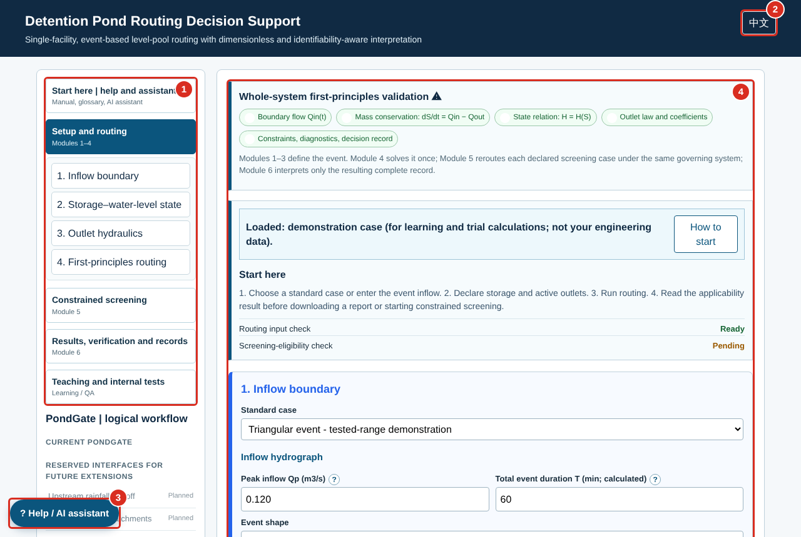

**Figure 1. Screen layout**

1. Left menu: start here, Modules 1–6, teaching
2. Language switch
3. Help / AI assistant button
4. Work area

## 3. Five-minute start with the demonstration case

1. The page opens with the "triangular event" demonstration case. It is not your engineering data.
2. Open "Setup and routing", scroll to the bottom and press **"Run routing and evaluation"**.
3. The page switches to "Results, verification and records". First check that the mass-balance residual is close to 0 %. Then read peak inflow, peak outflow and maximum water level.
4. To practise constrained screening, open "Teaching and internal tests", press "Load teaching example", then open "Constrained screening" and press "Run constrained design screening". The free-discharge ticks in the teaching case are practice assumptions only.
5. Press "Download reproducible decision-support report" to keep the record.

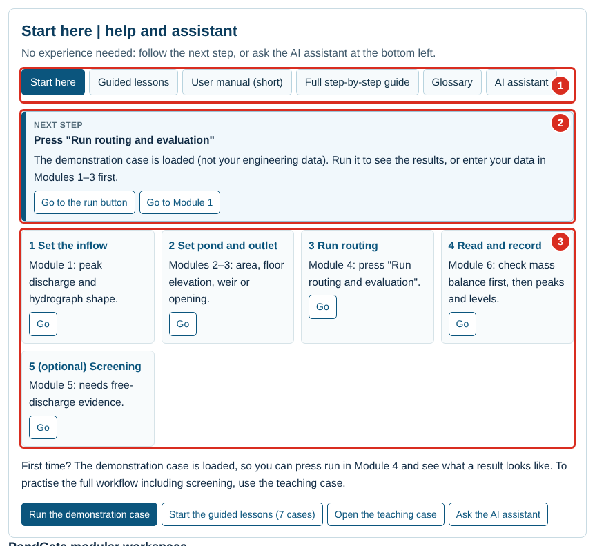

**Figure 2. The "Start here" page**

1. Tabs: start here, guided lessons, manual, glossary, AI assistant
2. Live next-step hint
3. Five steps with "Go" buttons

## 4. Guided lessons: learn the whole software in seven cases

"Start here → Guided lessons" holds seven lessons from simple to advanced. A lesson panel appears at the top right; each step is ticked automatically when done, then press "Next".

1. First routing run (demonstration case): run, read mass balance, download the report.
2. Your own event and pond: change Qp, Tp, Tr, area and weir width, and compare.
3. Long-duration event and peak timing: read FPI95 and use volume-time measures for a broad peak.
4. Find and fix a wrong input: the grey button and the red outline.
5. Constrained screening: complete free-discharge evidence and limits, get a feasible result, download the report.
6. No feasible solution: read the dominant limit and the right response.
7. Research-inspection mode: which outlet settings lock screening.

"Take me there" jumps to the field; "Show me" does the step for you. A lesson loads practice inputs and can restore yours at the end. Free-discharge ticks and records in the lessons are teaching assumptions, not for real projects.

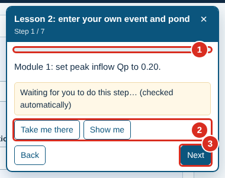

**Figure 3. Guided-lesson panel**

1. Progress bar and current step
2. "Take me there" and "Show me"
3. Press "Next" when the step is done

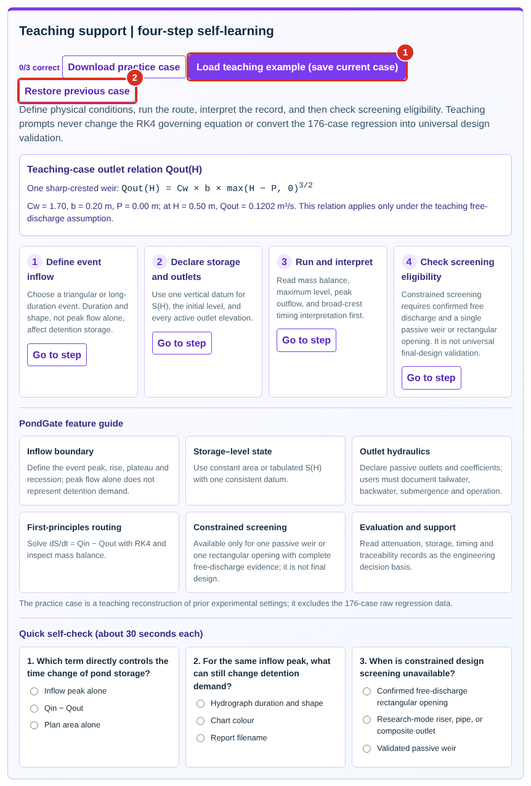

**Figure 4. Teaching case on the teaching page**

1. Load the teaching example that can run screening
2. Restore the previous case

## 5. Module 1: inflow boundary

- **Standard case**: triangular event, long-duration event, or user-defined event.
- **Peak inflow Qp** (m³/s) must be greater than 0.
- **Inflow shape**: a triangle uses time to peak Tp and recession time Tr (or Tp and the ratio Tp/Tr); a long-duration plateau uses rising, plateau and recession times. The total event duration T is calculated and cannot be typed.
- **Imported time–discharge pairs**: one pair per line, "time (min), discharge (m³/s)". The first time must be 0, times must increase, discharge must not be negative, and at least two lines are needed. Example: `0, 0`, `25, 0.10`, `50, 0.10`, `75, 0`.
- Peak discharge alone is not enough. Duration and shape also change the detention volume needed.

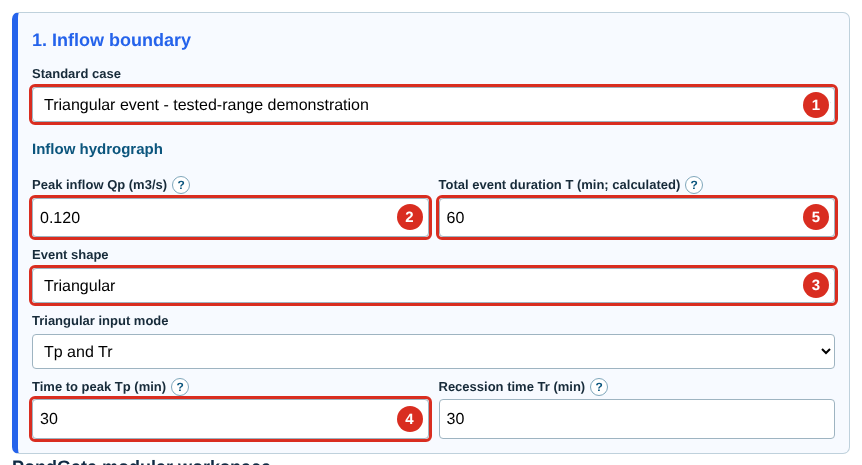

**Figure 5. Module 1, inflow boundary**

1. Standard case
2. Peak inflow Qp
3. Inflow shape
4. Time to peak Tp (and recession time Tr)
5. Total duration T (calculated)

## 6. Module 2: storage–water-level state

- **Constant plan area**: S(H) = A × (H − Hfloor). Only the plan area A (m², greater than 0) is needed.
- **Stage–storage table**: import a .csv or .txt file with two columns: water level (m), then storage (m³). Routing does not extrapolate beyond the table.
- **Floor elevation Hfloor**, **initial level H0** and every outlet elevation must use **one vertical datum**. For a relative datum set Hfloor = 0. H0 must not be below Hfloor.

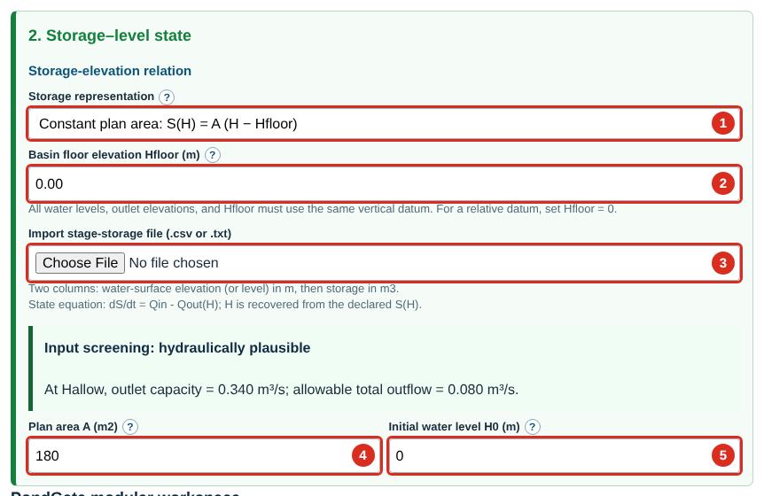

**Figure 6. Module 2, storage–water-level state**

1. Storage representation
2. Floor elevation Hfloor
3. Import a stage–storage table
4. Plan area A
5. Initial level H0

## 7. Module 3: outlet hydraulics and free-discharge evidence

- **Sharp-crested weir**: Qout = Cw × b × (H − P)^1.5. Enter weir coefficient Cw, width b and crest elevation P.
- **Rectangular opening**: Qout = Cd × Ao × √(2g (H − invert)). Enter Cd, opening area Ao and invert elevation.
- **Riser, circular pipe, level-dependent coefficient table and weir + opening combinations** are "research inspection": routing works, but constrained screening is locked.
- Coefficients can use presets (for example Cw = 1.70, Cd = 0.62) or a field-calibrated value. Presets suit preliminary screening only.
- **Free-discharge evidence**: before screening, tick "Free-discharge boundary confirmed" and the four checks (tailwater, backwater or pipe friction, submergence, operational control), and fill in the two records (free-discharge evidence and screening-limit source). **Tick them only when you hold drawings, a field inspection or a calculation that supports them.** The software does not verify these conditions for you.

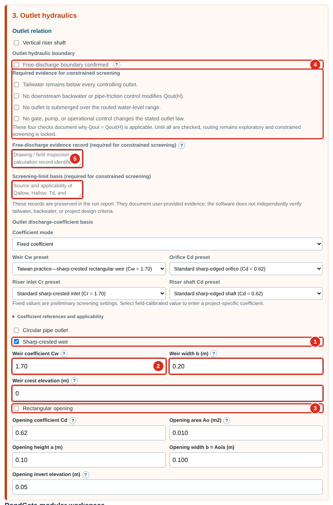

**Figure 7. Module 3, outlet hydraulics and free-discharge evidence**

1. Enable the sharp-crested weir
2. Weir coefficient Cw, width b, crest elevation
3. Rectangular opening (with the weir it is research inspection)
4. Free-discharge boundary and four checks
5. Two evidence records

## 8. Module 4: run routing

- Press **"Run routing and evaluation"**. Results appear in Module 6.
- A **grey** button means a field in Modules 1–3 is not valid. The fields to fix are listed above the button. Click one to jump to it (it is outlined in red).
- Common causes: Qp of 0 or less, plan area of 0, weir width or coefficient of 0, an outlet below the floor, or no outlet enabled.

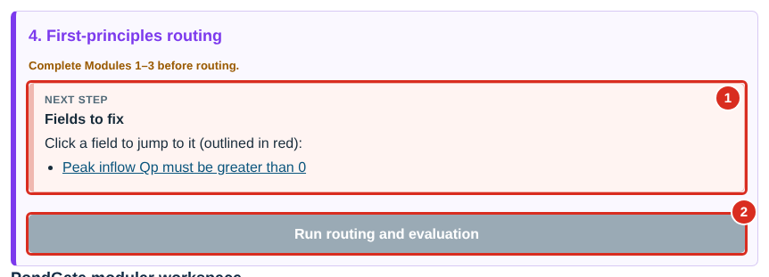

**Figure 8. Module 4: hint for a wrong input (Qp = −1)**

1. List of fields to fix; click to jump
2. Run button is grey and disabled

## 9. Module 6: reading the results

- **Check the mass-balance residual ε/Vin first**. It should be close to 0 %. Above 0.5 % the software asks you to resolve the numerical problem first.
- **Peak outflow Qp,o** and **peak ratio RQ**: a smaller RQ means more peak reduction.
- **Event-added detention volume ΔSmax** and **maximum level Hmax**: compare with the allowable level and freeboard.
- **Near-peak flatness FPI95**: a large value means a flat peak, so a single peak time is unreliable. Use the volume-time measures instead.
- Charts: the left chart shows inflow and outflow; the right chart shows water level and storage. "Display duration" sets the time axis.
- The three-step screening and optimization check covers Module 5 results only. After plain routing it shows "screening not yet run".

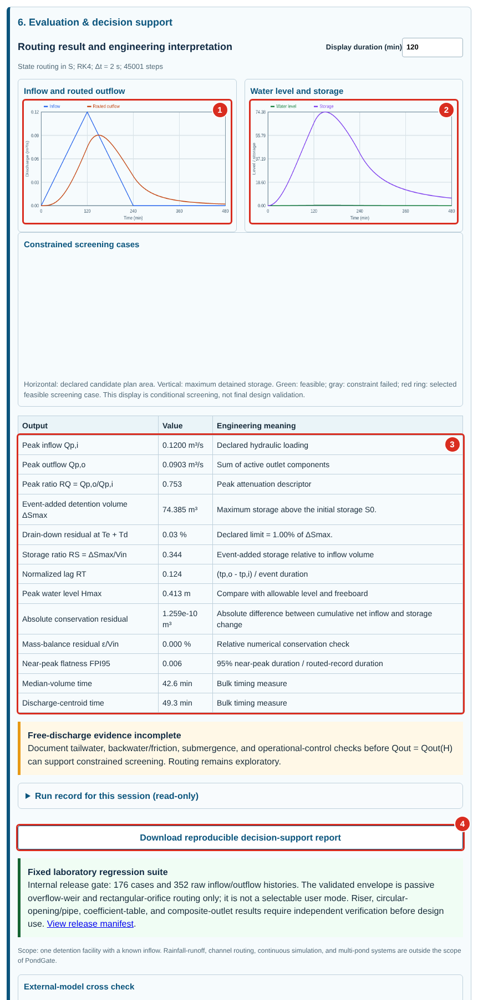

**Figure 9. Module 6, routing results**

1. Inflow and routed outflow
2. Water level and storage
3. Result table (check the mass-balance residual first)
4. Download the traceable report

## 10. Module 5: constrained screening and continuous optimization

- Opens only with a **single sharp-crested weir** or a **single rectangular opening**, fixed coefficients, the four free-discharge checks and both records complete.
- Enter the **allowable peak outflow Qallow** (m³/s) and the **allowable water level Hallow** (m). Both should come from a regulation or design criterion and be cited in the screening-limit record.
- **Maximum drain-down time Td** and **permitted residual percentage**: at Te + Td the event-added storage must not exceed that percentage of ΔSmax.
- The **reference level Href** only defines the dimensionless groups ΠQ and ΠS. It is not automatically a safety limit.
- Search bounds: enter minimum and maximum weir width b or opening area Ao. Each selected size is tested at five equally spaced values.
- After "Run constrained design screening", the page switches to Module 6 to show the result.
- **Continuous optimization** searches plan area A and one outlet size together between the area bounds. The result is not a proven global optimum.
- **No feasible solution**: the software shows "Blocked", the dominant limit (peak outflow, maximum level or drain-down residual) and a "Go to fix" link. Change the pond area or outlet size on engineering grounds. **Do not relax Qallow or Hallow just to obtain a solution.**

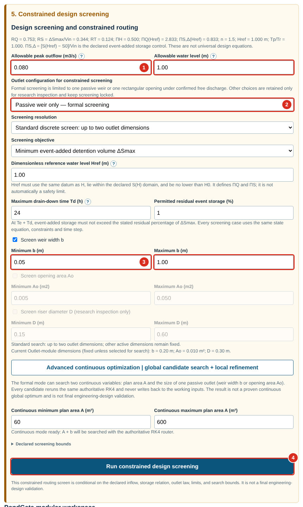

**Figure 10. Module 5, constrained-screening settings**

1. Allowable outflow Qallow and level Hallow
2. Outlet combination for screening
3. Search bounds (minimum and maximum weir width)
4. Run constrained design screening

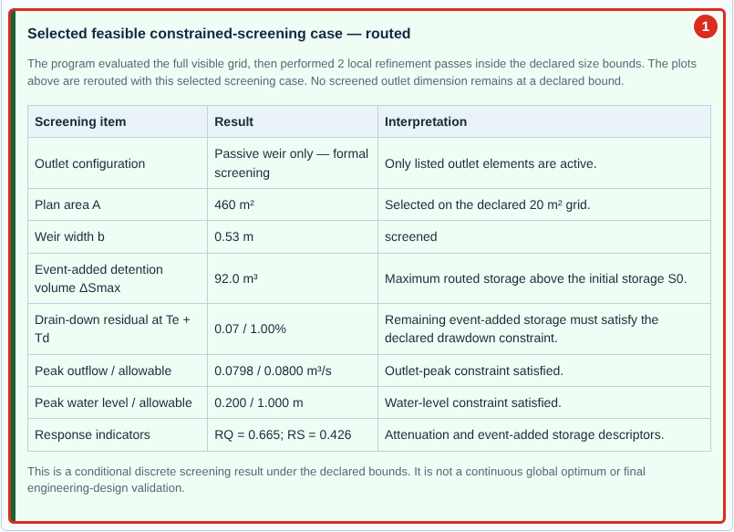

**Figure 11. Screening found a feasible case (shown in Module 6)**

1. Selected area, weir width and limit checks

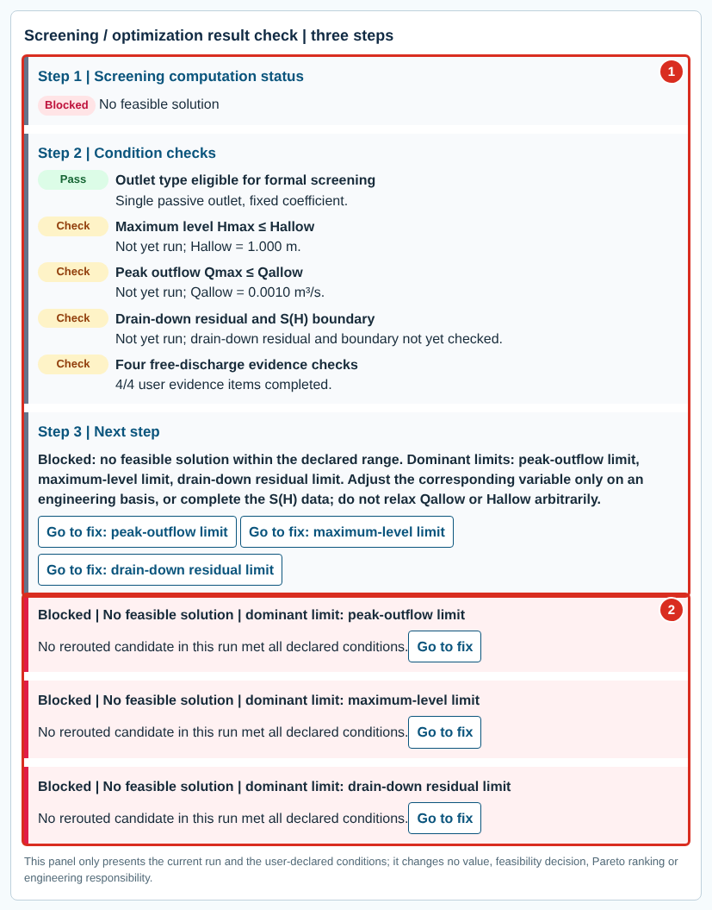

**Figure 12. Blocking diagnosis with no feasible solution**

1. Three-step check: status, conditions, next step
2. Blocked items with "Go to fix"

## 11. Reports and run records

- The read-only run record in Module 6 lists the inputs, method, results and limits of this run.
- "Download reproducible decision-support report" saves a text file with inputs, results and scope for your design file.
- When inputs change, the old result becomes invalid. Run again.

## 12. Comparing with HEC-HMS or SWMM

- In Module 6, "External model cross-check", choose the reference hydrograph (the current routing or public benchmark A-005 to D-005) and the external model.
- Import the external model's **actual simulation result CSV**. The first row holds column names. Required columns are time_s (or time, t) and outflow_m3_s (or qout, qo). A full comparison also needs incremental_storage_m3 (or s, storage).
- The external model must use the same inflow, initial level, S(H), Q(H), coefficients and timing. Agreement means numerical consistency only, not field validation.

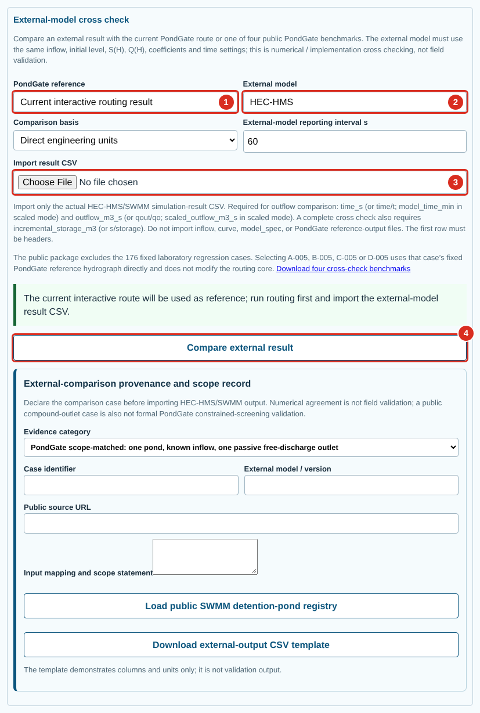

**Figure 13. External model cross-check**

1. PondGate reference hydrograph
2. External model (HEC-HMS / SWMM)
3. Import the external result CSV
4. Compare external results

## 13. Frequently asked questions

- **The button is grey?** Read the red list above the button and click a field name to fix it.
- **Screening stays locked?** Check that only one outlet is enabled, coefficients are fixed, and the four free-discharge checks and both records are complete.
- **"No feasible solution"?** This is a deliberate block: no design within the current bounds meets all limits. Adjust area or outlet size according to the dominant limit, or widen search bounds that you can justify.
- **Is my data uploaded?** No. Calculation, help and the AI assistant all run in your browser and send nothing.
- **Can a result serve as design approval?** No. It holds only under the declared conditions and needs a professional's judgement.

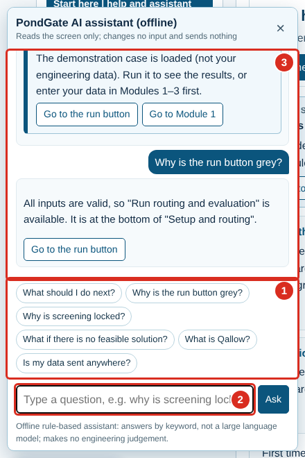

**Figure 14. AI assistant (offline)**

1. Common-question buttons
2. Type a question
3. Answers and the next-step hint

## Glossary

- **Peak inflow Qp**: Largest discharge of the inflow hydrograph (m³/s). Must be greater than 0.
- **Time to peak Tp**: Time for a triangular inflow to rise from 0 to its peak (min).
- **Recession time Tr**: Time for a triangular inflow to fall from its peak to 0 (min).
- **Total event duration T**: Total length of the inflow hydrograph (min), added up from the segment times. It cannot be typed.
- **Stage–storage relation S(H)**: Relation between water level H and stored volume S. With constant area, S = A × (H − Hfloor).
- **Plan area A**: Pond surface area in constant-area mode (m²). Must be greater than 0.
- **Floor elevation Hfloor**: Elevation of the pond floor (m). All levels and outlet elevations must share its datum.
- **Initial level H0**: Water level in the pond when the event starts (m). Must not be below Hfloor.
- **Vertical datum**: Common zero for elevations. Floor, levels, crest and invert must share it, or results are wrong.
- **Weir coefficient Cw**: Coefficient in the weir law Q = Cw × b × (H − P)^1.5. The 1.70 preset is for preliminary screening only.
- **Weir width b**: Crest length of the sharp-crested weir (m).
- **Crest elevation P**: Water starts to spill once the level exceeds this elevation (m).
- **Discharge coefficient Cd**: Coefficient in the opening law Q = Cd × Ao × √(2g(H − invert)). Preset 0.62.
- **Opening area Ao**: Area of the rectangular opening (m²) = height a × width b.
- **Invert elevation**: Lower edge of the rectangular opening (m). Outflow starts above it.
- **Research inspection**: Riser, pipe, coefficient-table or combined-outlet settings. Routing works but constrained screening is locked; independent verification is needed.
- **Free discharge**: Outlet flow depends only on pond level, not on tailwater, backwater, submergence or gate operation. Evidence and the four checks are required before screening.
- **Two evidence records**: "Free-discharge evidence" and "screening-limit source": cite drawing or inspection IDs, checker and date, and the source of limits such as Qallow and Hallow.
- **RK4**: Fourth-order Runge–Kutta method that steps dS/dt = Qin − Qout with a fixed Δt = 2 s.
- **Mass-balance residual ε/Vin**: Difference between cumulative net inflow and storage change, divided by inflow volume. Should be near 0 %; above 0.5 % the result must not be used.
- **Peak ratio RQ**: RQ = peak outflow ÷ peak inflow. Smaller means more peak reduction.
- **Event-added detention ΔSmax**: Largest storage added above the initial storage during the event (m³).
- **Storage ratio RS**: RS = ΔSmax ÷ inflow volume Vin.
- **Dimensionless lag RT**: RT = (time of peak outflow − time of peak inflow) ÷ event duration.
- **Maximum level Hmax**: Highest pond level during the event (m). Compare with Hallow and freeboard.
- **Near-peak flatness FPI95**: Share of routed time with outflow above 95 % of its peak. A large value means a flat peak, so a single peak time is unreliable.
- **Allowable peak outflow Qallow**: Upper limit of peak outflow in screening (m³/s), taken from a regulation or design criterion.
- **Allowable level Hallow**: Upper limit of the maximum level in screening (m). Must not be below H0.
- **Drain-down time Td and residual**: At event end Te plus Td, event-added storage must not exceed the stated percentage of ΔSmax.
- **Reference level Href**: Level used only to define the dimensionless groups ΠQ and ΠS (m). Not automatically a safety limit.
- **Dimensionless groups ΠH, ΠQ, ΠS**: Ratios that scale level, outlet capacity and storage by the inflow, used to compare cases. Not general design formulas.
- **Constrained screening**: Reruns routing over the declared bounds to find feasible pond areas and outlet sizes under the declared limits. Not a final design.
- **Continuous optimization**: Continuous search of area A and one outlet size between bounds, then local refinement. Not a proven global optimum.
- **Blocked / no feasible solution**: No candidate within the current limits and bounds meets every condition. The software shows the dominant limit and a correction path, never "pass".
- **Numerical consistency**: PondGate and HEC-HMS or SWMM give close results under identical inputs and physics. Not field calibration or general validation.
- **176-case regression**: Release check that reruns 176 laboratory cases (352 raw series) through the RK4 core. Peak-discharge MARE: A 2.924 %, B 2.954 %, C 4.104 %, D 4.649 %.
